<div align="center">


# Prescribble

*The AI that guesses your drawing before you finish it.*

A stroke-aware sketch recognizer: it reads your pen strokes as you draw and ranks what it thinks you are drawing after every stroke, with the model running inside your own browser.

<br>


-4169E1?style=for-the-badge&logo=postgresql&logoColor=white)


<br>

**Deep Learning Laboratory Project (course 2604733): Semester VII**
Faculty of Engineering and Technology, GLS University
B.Tech (CS&E)

**By**

| Name | Enrollment No. |
|---|---|
| Amulya Anamdasu | `202302626010004` |
| Dhiptanshu Malik | `202302626010036` |
| Aryan Panchal | `202302626010044` |
| Khush Purohit | `202302626010061` |

**Submitted to:** Dr. Madhuri Chopade, Prof. Twinkle Patel

</div>

---

## Contents

1. [What is Prescribble?](#1-what-is-prescribble)
2. [Features and screens](#2-features-and-screens)
3. [Datasets and data sources](#3-datasets-and-data-sources)
4. [How the models were trained](#4-how-the-models-were-trained)
5. [Methodologies and concepts](#5-methodologies-and-concepts)
6. [Results](#6-results)
7. [The pipeline explained](#7-the-pipeline-explained)
8. [Setup and installation](#8-setup-and-installation)
9. [Project structure](#9-project-structure)
10. [Data and database schemas](#10-data-and-database-schemas)
11. [API reference](#11-api-reference)
12. [Testing, limitations and ethics](#12-testing-limitations-and-ethics)
13. [References](#13-references)

---

## 1. What is Prescribble?

> **Name note.** "Prescribble" is a working name. The product name is an open decision for the project owner.

**The problem.** Most sketch recognizers need a finished drawing. A person drawing on a screen shows their intent long before the last stroke, and a recognizer that waits for the end throws that signal away.

**What it does**

1. You draw in the browser. Every pointer movement is stored as a stroke point in a fixed 0 to 255 coordinate frame.
2. The app turns the strokes so far into two views of the drawing: a 64x64 picture of the ink and a sequence of up to 128 stroke points.
3. A neural network that fuses both views returns a probability for each of 345 object classes. The Top-5 list updates after every stroke.
4. Around that, the app offers saving drawings, a daily challenge, live classrooms, a public REST API, an embeddable widget, and a consent-based loop that lets the model be retrained on drawings people choose to contribute.

**Why it is different**

| | |
|---|---|
| **Early, not final** | The model is trained on partial drawings: each training sample is cut at a random fraction of the drawing's ink length, so it learns to answer from 10 to 100% of the ink. |
| **Private by design** | Inference runs in the visitor's browser (ONNX Runtime Web). The server stores a drawing only if the user saves or submits it. |
| **Two views fused** | A CNN sees the shape, an LSTM follows the pen order; fusing them beat either alone at every completion level in the controlled comparison. |
| **One-command improvement loop** | `npm run flywheel` exports consented drawings, fine-tunes on a Kaggle GPU, compares against the live model and only promotes through an accuracy gate. |

**Scope.** Accuracy figures are measured on held-out Google QuickDraw sketches (see [Section 6](#6-results)).

---

## 2. Features and screens

| Screen (route) | What it does |
|---|---|
| **Studio** (`/studio`) | Free draw with live Top-5 guesses and a confidence-over-time chart; an **AI challenge** mode; **Watch real sketches** replays held-out QuickDraw sketches through the real model. Saving a drawing needs an account. |
| **Landing** (`/`) | A live demo: a real held-out sketch replayed stroke by stroke through the real model, with the model's measured numbers. |
| **Daily challenge** (`/challenge`) | One word a day; up to 3 scored attempts per user per UTC day; leaderboard. Scores are computed on the server with the same pipeline code the model was trained with. |
| **Classrooms** (`/classroom`, `/join`, `/room/:id`) | A teacher opens a room; students join with a 6-character code and a nickname (**no account**). Timed rounds with one word, live updates over a WebSocket, scores hidden until the round ends. |
| **Gallery** (`/gallery`) | Saved drawings, stroke-by-stroke replay through the model, export as a `.webm` video, optional public share link (`/d/:token`). |
| **Stats** (`/stats`) | Per-user numbers computed from saved drawings. |
| **Teach the AI** (`/teach`) | After explicit consent, shows the word the model has the fewest examples of and records your drawing as a confirmed training example. One-click withdrawal. |
| **Developers** (`/developers`) | Live widget demo, cURL / Python / Node examples (captured from the real system and guarded by a test), error table, API key manager. |
| **Settings** (`/settings`) | Profile, leaderboard-name switch, training-consent switch (off by default), data export, account deletion. |
| **Admin** (`/admin`) | Admin-only metrics (accounts, drawings, keys, request chart, training-ready counts). Admins are promoted only from the server command line. |
| **Embeddable widget** | `<prescribble-canvas>` custom element (`packages/widget`); runs the model in the host page's browser and sends nothing out. |
| **REST API** | `POST /api/v1/predict` with a secret API key, for backends and other languages. |

The light and dark themes and an offline mode (the Studio works with no backend) are built in.

---

## 3. Datasets and data sources

### (a) Training and evaluation data

| Dataset | Used for | How |
|---|---|---|
| **Google QuickDraw**, "simplified" stroke files, CC BY 4.0 | All sketch models | Streamed with HTTP range requests (`src/data/download.py`) from `storage.googleapis.com/quickdraw_dataset/full/simplified/`; only drawings flagged `recognized` with at least 4 points are kept. Three class sets: **v1** 30 classes, **v2** 100, **v3** all 345 categories (`src/classsets.py`). |
| **MNIST** (via torchvision) | Digit CNN, autoencoders, VAE, GAN, the NumPy MLP, and the scenes for object detection | Downloaded on first use. |
| **IMDB reviews** (Keras-hosted `imdb.npz`, 25k train / 25k test) | An LSTM sentiment-analysis side experiment | `src/train/sentiment_lstm.py`. |
| **Consented user drawings** from the app | Fine-tuning (`/teach` and saved drawings) | Only with consent on, a label the person confirmed, a class the live model knows, no duplicates. |

Data splits and sizes are in [Section 4](#4-how-the-models-were-trained).

### (b) Pretrained models

| Model | Source | Role |
|---|---|---|
| ResNet18, VGG16 (ImageNet weights) | torchvision | Transfer-learning comparisons on sketches (not deployed). |
| YOLOv8n (COCO weights) | Ultralytics | Transfer vs random-init comparison on digit scenes (not deployed). |

No pretrained weights are in the deployed model. It is trained from scratch.

### (c) External services

| Service | Role | Key needed? | Limits |
|---|---|---|---|
| Google Cloud Storage (QuickDraw, Keras IMDB) | Training data download | No | Public files |
| Kaggle (free GPU kernels, datasets) | Training and the retraining loop | **Yes**, a Kaggle account and API credentials (see [Section 8](#8-setup-and-installation)) | Kaggle's free GPU quota (not measured here) |
| jsDelivr / CDN (Swagger viewer for `/api/docs`) | Only the interactive API reference page | No | The page is deliberately exempt from the content security policy |

Nothing at runtime calls a third-party API: the app, the model and the WebAssembly runtime are all served from the same origin.

---

## 4. How the models were trained

**Data preparation.** Each QuickDraw drawing is an array of `(x, y, end_of_stroke)` points in a fixed 0 to 255 frame. A **partial drawing** is the first fraction of the drawing's total *ink length* (not stroke count), so a cut can fall mid-stroke. The partial drawing is **not re-normalised**: a live user's unfinished drawing has no final bounding box, so the canvas uses the same fixed frame. The two inputs are a 64x64 raster (2-pixel lines, anti-aliased) and a sequence of up to 128 points with five features `(x, y, dx, dy, new_stroke)`.

**Training stream.** Every sample is generated on the fly from its id: whole-drawing augmentation *before* cutting (horizontal flip, rotation within 12 degrees, scale 0.7 to 1.1, shift up to 14 pixels, Gaussian jitter 0.8), then a completion fraction drawn half of the time from 12 to 40% and otherwise from 10 to 100%. Evaluation uses fixed fractions: 10, 20, 30, 50, 75 and 100%.

**Splits.**

| Model | Train | Validation | Test |
|---|---|---|---|
| v1 (30 classes) | 96,000 (3,200 per class) | 9,000 (300 per class) | 9,000 (300 per class) |
| v3 (345 classes) | 8.27 million (up to 24,000 per class; 5 classes had slightly fewer) | 100 per class | 300 per class |

Validation is used for choosing the best epoch (highest mean Top-1 over the six fractions, saved as `best.pt`). The test split is used once, at the end, by `src/train/train.py`.

**Architecture** (`src/models/nets.py`). A CNN branch (stride-2 stem, then three double-conv blocks with batch norm and max-pooling, dropout 0.3, dense layer) and a 2-layer LSTM branch (dropout 0.2) over the stroke sequence, concatenated and fed to a classifier head (hidden layer, dropout 0.3) and to a convolutional **ghost decoder** that is trained to reconstruct the completed drawing. The decoder is part of the exported model but the app no longer displays it.

**Hyper-parameters**

| | v1 `fusion_ghost` | v3 `fusion_ghost_xl` (live) |
|---|---|---|
| Parameters | 4.5 M | 8.6 M (`cnn_width` 1.5, `cnn_out` 384, LSTM hidden 256, head 512) |
| Optimiser | AdamW, weight decay 1e-4 | same |
| Schedule | OneCycle, max lr 3e-3 | OneCycle, max lr 3e-3 |
| Batch size | 256 | 256 |
| Epochs x samples per epoch | 20 x 100,000 (`kaggle/kernel/train_kaggle.py`) | 48 x 300,000 (`kaggle/v3/run_v3.py`) |
| Loss | cross-entropy (label smoothing 0.05) + ghost BCE (positive weight 4.0, weight 1.0) | same |
| Seed | `torch.manual_seed(0)` | same |
| Hardware | Kaggle GPU | Kaggle GPU, 3.6 hours |

The v1 table in [Section 6](#6-results) also includes ablations (MLP, CNN, LSTM, fusion without ghost, ResNet18) trained with the same script on the same data.

**Fine-tuning on user drawings** (`kaggle/finetune/run_finetune.py`, `src/flywheel/finetune.py`): starts from the live model's checkpoint, 6 epochs of 60,000 samples, learning rate 4e-4, user drawings mixed in at no more than 25% of the stream and capped so no drawing is seen more than about 10 times.

```mermaid
flowchart LR
    subgraph DATA["Data preparation"]
        A["QuickDraw ndjson<br/>(range download)"] --> B["parse and filter<br/>recognized, 4+ points"]
        B --> C["split per class<br/>train / val / test"]
        C --> D["packed uint8 arrays<br/>memory-mapped"]
    end
    subgraph STREAM["Training stream"]
        D --> E["augment whole drawing"]
        E --> F["cut at random ink fraction"]
        F --> G["raster 64x64 +<br/>sequence 128x5"]
    end
    subgraph TRAIN["Training on Kaggle GPU"]
        G --> H["CNN + LSTM fusion<br/>classifier + ghost decoder"]
        H --> I["validate each epoch<br/>keep best.pt"]
    end
    subgraph SHIP["Export and release"]
        I --> J["test at 6 fractions"]
        J --> K["export ONNX +<br/>meta, results, samples"]
        K --> L["register in<br/>models/registry.json"]
        L --> M{"accuracy gate<br/>passed?"}
        M -- yes --> N["promote: live"]
        M -. no .-> O["stay on live model"]
    end
```

---

## 5. Methodologies and concepts

| Concept | Where it appears |
|---|---|
| Multilayer perceptron with manual backpropagation (NumPy, checked against numerical gradients) | `src/models/mlp_numpy.py`, `src/train/mlp_baseline.py`; baseline on MNIST and on sketch rasters |
| Convolutional neural network (conv blocks, batch norm, dropout, pooling) | `CNNEncoder` in `src/models/nets.py`; `src/syllabus/digit_cnn.py` |
| Recurrent network / LSTM over a sequence | `LSTMEncoder` (stroke points); `src/train/sentiment_lstm.py` (IMDB reviews) |
| Feature fusion (concatenate image and sequence embeddings) | `SketchNet` |
| Multi-task learning (classification + reconstruction) | the ghost decoder trained jointly, `GhostDecoder` |
| Partial-input training (random completion fraction) | `src/data/dataset.py`, `src/data/partial.py` |
| Data augmentation before cutting | `augment` in `src/data/partial.py` |
| Label smoothing, class-weighted BCE | `src/train/train.py` |
| AdamW and one-cycle learning-rate schedule | `src/train/train.py`, several experiments |
| Top-1 / Top-5 accuracy at fixed completion fractions | `evaluate` in `src/train/train.py`; `src/eval/` |
| Convolutional autoencoder, denoising autoencoder, bottleneck size | `src/syllabus/ae.py` |
| Variational autoencoder: reparameterisation trick, KL term, beta weighting | `src/syllabus/vae.py` |
| Generative adversarial network (DCGAN, non-saturating loss, label smoothing), judged with a classifier-based score | `src/syllabus/gan.py` |
| Object detection: grid cells, GIoU loss, NMS, average precision (written from scratch) | `src/syllabus/detection/` |
| Transfer learning: frozen features vs full fine-tuning (VGG16, ResNet18, YOLOv8n) | `src/syllabus/vgg_transfer.py`, `src/syllabus/detection/train_yolov8.py`, `ResNetEncoder` |
| Model export and parity check (ONNX vs PyTorch) | `src/export/to_onnx.py` |
| In-browser inference (WebAssembly runtime) | `packages/engine` |
| Accuracy-gated model promotion, shared-class comparison, rollback | `src/flywheel/gate.py`, `src/flywheel/registry.py` |
| Consent-gated data collection and a stable train / held-out split | `apps/api/app/services/training_data.py`, `src/flywheel/dataset.py` |
| Password hashing (argon2), signed session cookies, hashed API keys, rate limiting | `apps/api/app/` |

---

## 6. Results

All numbers below are read from the saved result files (`models/*/results.json`, `report/syllabus_results/`, `docs/results/`). Each is a **single training run**: there are no seeds or confidence intervals.

### Sketch recognition: model comparison (30 classes, 9,000 held-out test sketches)

Top-5 accuracy (%) by share of the drawing completed:

| Model | 10% | 20% | 30% | 50% | 75% | 100% |
|---|---:|---:|---:|---:|---:|---:|
| MLP (NumPy, from scratch) | 59.1 | 72.7 | 78.3 | 82.0 | 84.1 | 83.3 |
| CNN | 74.3 | 89.2 | 93.9 | 96.8 | 98.3 | 98.4 |
| LSTM (stroke sequence) | 77.8 | 90.3 | 94.1 | 96.4 | 98.2 | 98.5 |
| CNN + LSTM fusion | **78.4** | **90.8** | **94.8** | **97.1** | **98.6** | **98.8** |
| CNN + LSTM + ghost decoder (v1) | 77.6 | 90.6 | 94.3 | 97.0 | **98.6** | **98.8** |
| ResNet18 (ImageNet) + LSTM + ghost | 72.7 | 87.9 | 92.3 | 95.7 | 98.0 | 98.5 |

Top-1 accuracy (%):

| Model | 10% | 20% | 30% | 50% | 75% | 100% |
|---|---:|---:|---:|---:|---:|---:|
| MLP (NumPy, from scratch) | 20.2 | 32.7 | 40.3 | 44.5 | 49.2 | 49.7 |
| CNN | 33.0 | 54.9 | 66.4 | 75.1 | 85.7 | 89.8 |
| LSTM (stroke sequence) | 35.2 | 55.8 | 67.3 | 74.7 | 84.2 | 88.3 |
| CNN + LSTM fusion | 35.4 | **58.1** | **68.2** | 76.5 | **87.3** | 90.7 |
| CNN + LSTM + ghost decoder (v1) | **35.9** | 57.9 | 68.1 | **77.1** | 86.9 | **91.6** |
| ResNet18 (ImageNet) + LSTM + ghost | 31.8 | 53.9 | 65.3 | 75.5 | 86.7 | 91.3 |

### Model generations (each measured on held-out sketches of its own classes)

| Model | Classes | Top-5 at 30% of the ink | Top-1, finished drawing | Top-5, finished drawing | Size | CPU time per prediction |
|---|---:|---:|---:|---:|---:|---:|
| v1 | 30 | **94.3%** | **91.6%** | **98.8%** | 17.9 MB | 4.8 ms |
| v2 | 100 | 79.7% | 78.8% | 95.5% | 18.0 MB | 5.3 ms |
| **v3 (live)** | **345** | 62.3% | 72.0% | 93.2% | 34.5 MB | 12.0 ms (about 47 ms in the browser) |

More classes make the task harder, so these rows are not like for like. Comparing on the classes two models **share** (neither trained on them as held-out; both limited to the shared classes; Top-5 averaged over 20, 30 and 50% of the ink), from `docs/results/gate_*.json`:

| Comparison | Older model | Newer model |
|---|---:|---:|
| v1 vs v3 on the original 30 classes (900 sketches) | 92.8% | **95.4%** |
| v2 vs v3 on the shared 100 classes (3,000 sketches) | 79.4% | **85.2%** |

For v3, 34 of 345 classes reach 90% Top-1 on the finished drawing, 311 reach 50% and 12 stay below 30%; the easiest are *The Mona Lisa*, *ladder* and *star* (96 to 97%), the hardest *line* (5%), *bear* and *cooler* (11%). Per-class tables: [`report/GENERATIONS.md`](report/GENERATIONS.md).

<!-- eval:start -->
### Evaluation of v1, v2 and v3 in detail

The shipped ONNX files re-scored on the same unseen held-out sketches (v1 750, v2 2,500, v3 8,625 sketches, each model on its own classes), cut at nine ink fractions. Full tables, per-class lists and method: [`report/EVALUATION.md`](report/EVALUATION.md); raw numbers: [`docs/results/evaluation.json`](docs/results/evaluation.json); regenerate with `python -m src.eval.score_models && python -m src.eval.model_report`.

| Model | Classes | Top-1 @30% | Top-5 @30% | Top-1 @100% | Top-5 @100% | Macro F1 @30% | Macro F1 @100% | ECE @30% | Top-1 right by 30% |
|---|---:|---:|---:|---:|---:|---:|---:|---:|---:|
| v1 | 30 | 67.6 | 92.8 | 91.1 | 98.3 | 67.1 | 90.9 | 0.055 | 74.3 |
| v2 | 100 | 45.4 | 80.0 | 77.8 | 95.0 | 44.9 | 77.5 | 0.079 | 54.4 |
| v3 | 345 | 30.4 | 62.6 | 71.9 | 93.4 | 29.3 | 71.0 | 0.031 | 34.9 |

On sketches of the 30 original classes only (750 sketches), the like-for-like comparison:

| Model | Answers allowed | Top-5, mean of 20/30/50% | Top-1 @30% | Top-5 @100% |
|---|---|---:|---:|---:|
| v1 | only the 30 | 92.9 | 67.6 | 98.3 |
| v2 | restricted to the 30 | 91.9 | 65.3 | 97.6 |
| v2 | free (any of 100) | 78.3 | 46.3 | 93.2 |
| v3 | restricted to the 30 | 95.3 | 71.2 | 99.3 |
| v3 | free (any of 345) | 66.1 | 35.3 | 94.4 |

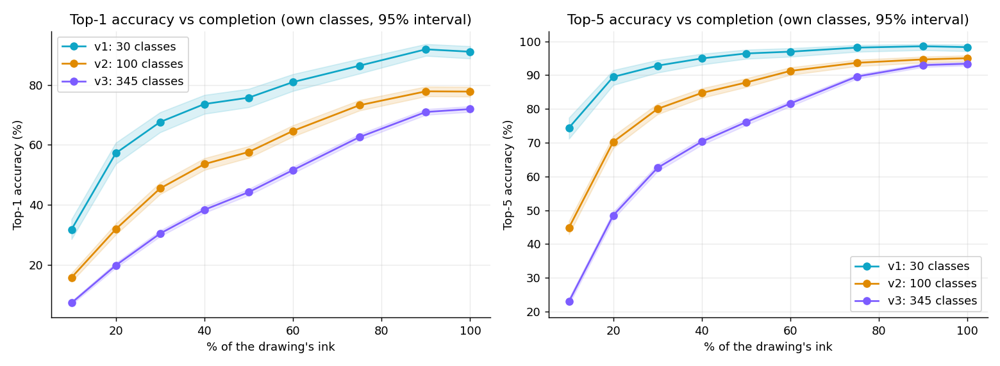

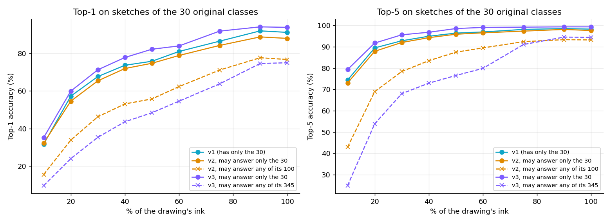

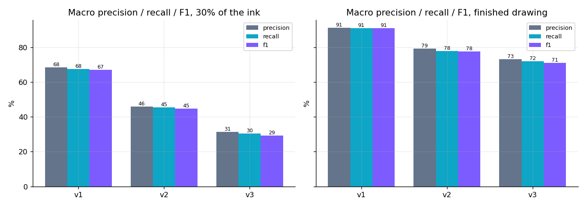

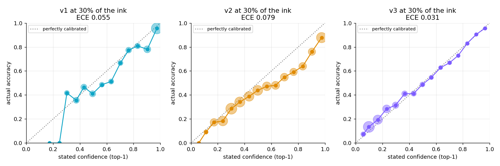

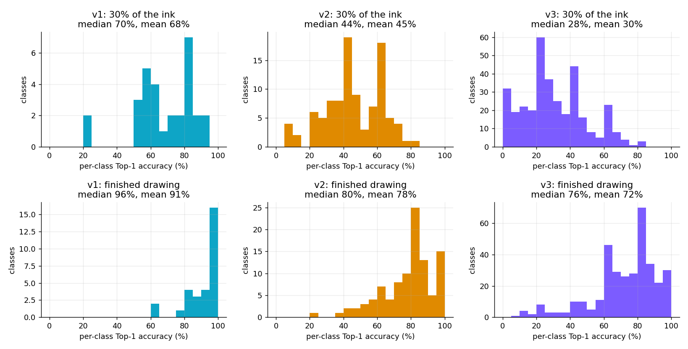

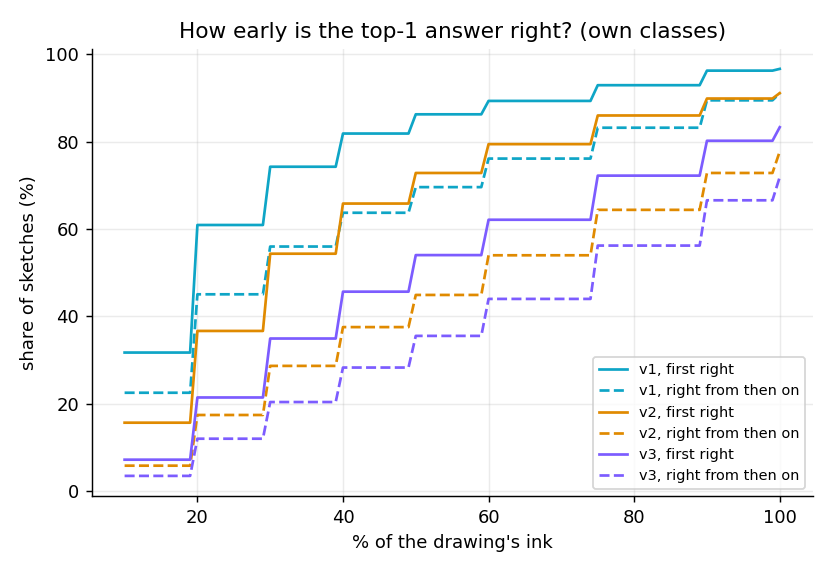

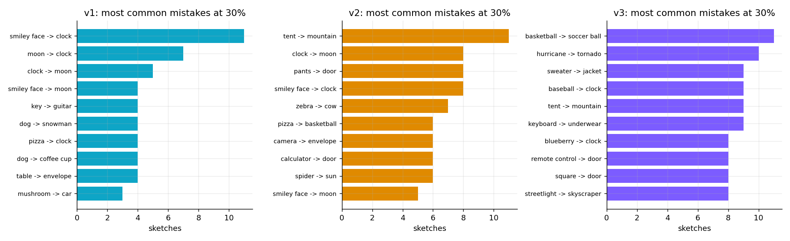

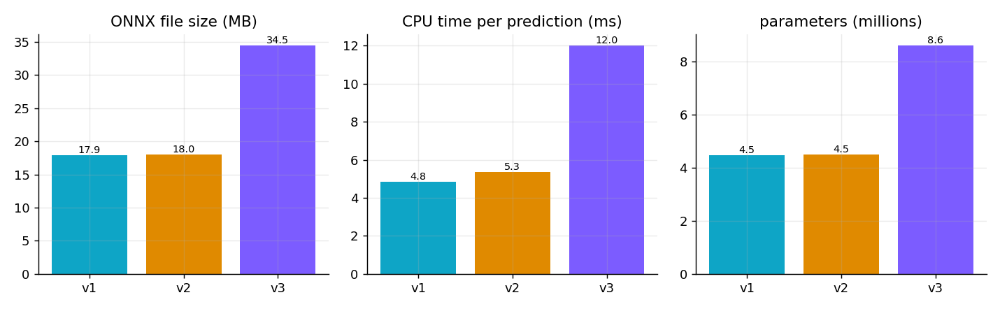

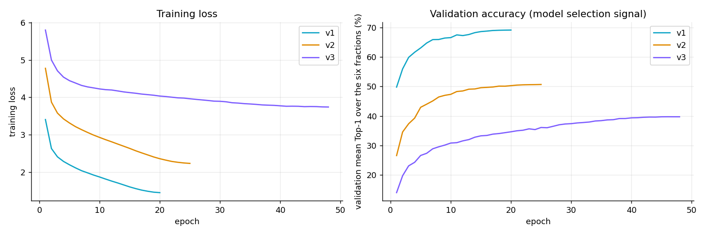

<!-- eval:end -->

### Supporting experiments (MNIST, detection scenes, sketches)

| Experiment | Result |
|---|---|
| MNIST test accuracy: NumPy MLP vs CNN | 97.85% vs **99.66%** (215 vs 34 errors in 10,000) |
| Convolutional autoencoder, held-out MSE for bottleneck z = 2 / 8 / 32 | 0.0448 / 0.0182 / **0.0045** |
| Denoising (noise std 0.5), MSE to the clean image | denoising AE **0.0119**, plain AE 0.0890, noisy input 0.1157 |
| VAE, reconstruction + KL (nats), z = 16, beta = 1 | **101.5** (beta 0.1: 114.9; beta 4: 116.7) |
| DCGAN scored with the digit CNN | real digits: confidence 0.956, score 7.75; GAN samples: 0.743, 3.84 |
| Detection on digit scenes, mAP@0.5 / mAP@[0.5:0.95] | YoloLite from scratch 99.31 / 94.10; YOLOv8n random init 99.39 / 92.69; YOLOv8n COCO-pretrained **99.59 / 94.41** |
| Transfer on sketches, Top-5 at 30% | small CNN 93.9; VGG16 frozen 88.9; VGG16 fine-tuned 93.7; ResNet18 fine-tuned 92.0 |
| IMDB sentiment, LSTM test accuracy | 85.67% |

Sources and discussion: [`report/SYLLABUS.md`](report/SYLLABUS.md), [`report/REPORT.md`](report/REPORT.md).

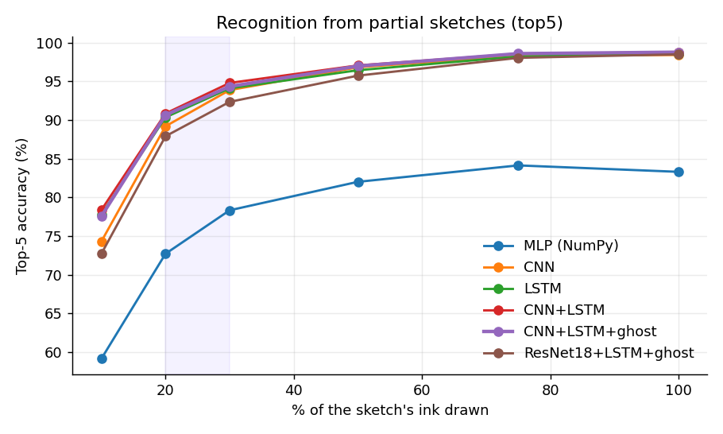

**Reading the results.** Fusing the CNN and the LSTM beats either alone at every completion level, most of all when little ink is drawn, because appearance and pen order carry different information. Adding the ghost decoder leaves classification essentially unchanged (94.3% vs 94.8% Top-5 at 30%, inside the noise of a single run). ImageNet pretraining did **not** help on sketches: fine-tuned VGG16 and ResNet18 match the small CNN, frozen features are clearly worse, and YOLOv8n pretraining moves mAP@0.5 by only 0.2 points on easy digit scenes. The 345-class model is better than v1 and v2 on the classes they share, but a single prediction is harder because look-alike classes compete.

**Scope of the numbers.** They are measured on held-out QuickDraw sketches. Each model is one training run, so differences of about a point are within what another run could change.

---

## 7. The pipeline explained

1. **Capture.** `DrawingBoard` records pointer events (mouse, touch or pen) as strokes in the model's 0 to 255 frame, independent of the canvas size. The pointer type of the first stroke is kept, because the mouse-vs-phone gap is the reason for the retraining loop.
2. **Prepare the inputs.** `packages/engine` rasterises the strokes to a 64x64 image and builds the 128-step, 5-feature sequence. It is golden-tested against `src/data/partial.py`: sequence features match exactly and the raster's mean pixel difference is under 0.01.
3. **Predict.** The same ONNX model runs in the browser (ONNX Runtime Web, WebAssembly) and on the server (ONNX Runtime). The app loads whichever version `models/registry.json` marks live; the file is never cached.
4. **Show.** The Top-5 list, a certainty value (1 minus entropy) and a confidence-over-time chart update after every stroke. Drawings stay in the browser unless the user saves or submits them.
5. **Score (challenge and classrooms).** A submitted drawing is replayed on the server at increasing ink fractions with the live model's version pinned for that day or round, so a promotion mid-day does not change the rules. The server uses the training pipeline's own code, so browser and server agree.
6. **Collect (opt-in).** A drawing is training-ready only if consent is on now, the person confirmed the label, the label is a class of the live model and it is not a duplicate. Classroom drawings are never training data.
7. **Retrain and release.** `npm run flywheel` exports, checks there are enough held-out real drawings, fine-tunes on Kaggle, installs the result as a candidate, compares it with the live model through the gate, and only then asks whether to promote.

Fallbacks: with no backend the web app starts in offline mode (Studio only); a failed Kaggle step stops the cycle and `--resume` skips finished steps; a failed gate never promotes.

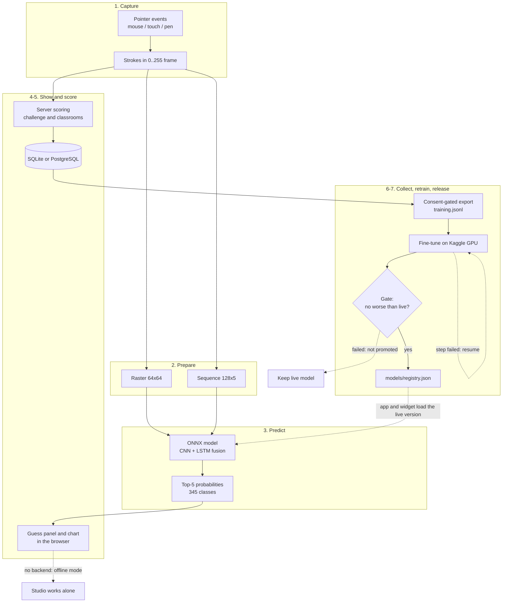

---

## 8. Setup and installation

### Prerequisites

| Tool | Version | Needed for |
|---|---|---|
| Python | 3.11 or newer (3.11.9 used here; the Docker image uses 3.12) | API, training code |
| Node.js and npm | 20 or newer (24.13 used here) | Web app, engine, widget |
| A modern browser | Edge or Chrome tested | Running the app and the browser tests |
| Docker | optional | Container build (see below) |
| Kaggle account and CLI | optional | Training and `npm run flywheel` |
| GPU | not needed to run the app | Training is slow on CPU (a fusion epoch is about 25 minutes on a laptop) |

### Install

```bash
git clone <REPO-URL>            # placeholder: this repository has no remote configured yet
cd Sketch_Evolution_DLL
python -m venv .venv
```

Activate the environment: `source .venv/bin/activate` (macOS / Linux) or `.venv\Scripts\activate` (Windows). Then:

```bash
npm install
pip install -r apps/api/requirements-dev.txt
```

### Environment file (`.env`)

Settings are read from `PRESCRIBBLE_*` environment variables, or from a `.env` file in the folder where you start the API (`apps/api/.env`). **Never commit it** (it is git-ignored). Every variable is optional in development.

```ini
# apps/api/.env  (all values are placeholders)
PRESCRIBBLE_ENV=dev                         # dev | test | prod ; prod requires a strong secret and secure cookies
PRESCRIBBLE_SECRET_KEY=                     # >= 32 random characters, required in prod:  python -c "import secrets; print(secrets.token_urlsafe(48))"
PRESCRIBBLE_DATABASE_URL=sqlite:///./prescribble.db
PRESCRIBBLE_CORS_ORIGINS=["http://localhost:5173"]
PRESCRIBBLE_MODEL_VERSION=                  # pin a model version; empty = the live one in models/registry.json
PRESCRIBBLE_ATTEMPTS_PER_DAY=3
PRESCRIBBLE_API_PER_MINUTE=60
PRESCRIBBLE_API_DAILY_LIMIT=1000
PRESCRIBBLE_MAX_ROOM_MEMBERS=60
```

The full list with defaults is in [`apps/api/app/config.py`](apps/api/app/config.py) and [`docs/DEVELOPMENT.md`](docs/DEVELOPMENT.md). There are no third-party API keys. The only credentials in the project are your own Kaggle credentials, which live outside the repository (see the Kaggle section below).

### Run in development (two terminals)

```bash
# 1. API on http://localhost:8100  (interactive docs at /api/docs)
cd apps/api
python -m uvicorn app.main:create_app --factory --port 8100
```

```bash
# 2. Web app on http://localhost:5173 (proxies /api to the API)
npm run dev:web
```

Port 8100 is used because 8000 belongs to another project on the development machine. The web app also works with no API running (offline mode).

### Run as one process (production-like)

```bash
npm run build:web
cd apps/api
PRESCRIBBLE_WEB_DIST=../web/dist python -m uvicorn app.main:create_app --factory --port 8100       # macOS / Linux
```

```powershell
npm run build:web
cd apps/api
$env:PRESCRIBBLE_WEB_DIST = "../web/dist"; python -m uvicorn app.main:create_app --factory --port 8100   # Windows PowerShell
```

### Verify it works

```bash
curl http://localhost:8100/healthz              # {"status":"ok"}
cd apps/api && python -m pytest -q              # API: 179 passed
npm test                                        # unit tests: engine 6, widget 10, web 30
npm run typecheck && npx eslint .
python -m pytest tests -q                       # ML pipeline: 60 passed
```

Browser tests (32 Playwright tests defined, they take several minutes): `npm run build:web && cd apps/web && PW_CHANNEL=msedge npx playwright test` (Windows / Edge; use `chrome` or run `npx playwright install chromium` elsewhere).

### Teach the AI: retrain on Kaggle with one command

This is the loop that turns drawings people contributed (through `/teach` or by saving drawings with training consent on) into a new model version.

```bash
npm run flywheel                         # = python -m src.flywheel.cycle
python -m src.flywheel.cycle --dry-run   # only export and check: is there enough data, what would be sent?
python -m src.flywheel.cycle --promote   # promote without asking if the gate passes (--no-promote: never)
python -m src.flywheel.cycle --resume runs/flywheel/<run>    # continue an interrupted run; finished steps are skipped
```

One-time Kaggle setup: install the Kaggle command line (`pip install kaggle`), create an API token in your Kaggle account settings and place it where the CLI expects it (`~/.kaggle/kaggle.json`, or `%USERPROFILE%\.kaggle\kaggle.json` on Windows). The cycle looks for `.venv-tools/Scripts/kaggle.exe`, then the `KAGGLE` environment variable, then `kaggle` on the path. The default Kaggle account name in the code is the original author's; **pass your own with `--kaggle-user <name>`**.

What the command does (each step is recorded in `runs/flywheel/<run>/state.json`):

| Step | Action |
|---|---|
| export | Consented, label-confirmed drawings from the app database (`apps/api/prescribble.db` unless `--database-url`) |
| check | Stops unless there are at least 30 held-out real drawings (about 150 in total): a gain measured on fewer means nothing |
| data, code | Publishes `training.jsonl` as the private dataset `sketch-evolution-userdata` and the source as `sketch-evolution-data` |
| train | Pushes the fine-tune kernel (`kaggle/finetune/run_finetune.py`) and waits for it (about an hour) |
| download, install | Fetches the output, checks every step succeeded, adds `models/vN` as a registered candidate |
| compare | Registry gate on QuickDraw and on the held-out real drawings; result saved in `docs/results/gate_<live>_to_<new>.json` |
| promote | Only if the gate passed and you answer yes (or pass `--promote`) |

After a promotion run `npm run build:web` (the web build ships only the live model), then restart the API or call `POST /api/v1/admin/model/reload` as an admin. Details, data rules and honest limits: [`docs/FLYWHEEL.md`](docs/FLYWHEEL.md).

<details>
<summary><b>Build the data and models from scratch (advanced, slow)</b></summary>

```bash
pip install -r requirements.txt
python -m src.data.download && python -m src.data.preprocess          # v1: 30 classes, pickle form
python -m src.train.mlp_baseline mnist && python -m src.train.mlp_baseline sketch
python -m src.train.train --model cnn                                 # also: lstm, fusion, fusion_ghost, resnet_ghost
python -m src.eval.collect && python -m src.export.samples
python -m src.export.to_onnx --model fusion_ghost                     # writes models/v1 (--version v2 for a new one)
python -m src.eval.analysis && python -m src.eval.report
```

The 345-class model needs the packed form and a GPU: `PRESCRIBBLE_CLASS_SET=v3 python -m src.data.preprocess --packed --train 24000`, then the driver `kaggle/v3/run_v3.py` (run as a Kaggle kernel: `python scripts/build_kaggle_dataset.py <user>`, `kaggle datasets create`, `kaggle kernels push -p kaggle/v3`). The supporting experiments are `python -m src.syllabus.digit_cnn` (then `ae`, `vae`, `gan`, `detection.train_scratch`, `detection.train_yolov8`, `vgg_transfer`) and `python -m src.train.sentiment_lstm`. Add `--smoke` to the `src.syllabus` scripts for a tiny check.

</details>

<details>
<summary><b>Docker</b></summary>

```bash
cp deploy/.env.example deploy/.env           # set SECRET_KEY; COOKIE_SECURE=true behind HTTPS
docker compose -f deploy/docker-compose.yml --env-file deploy/.env up -d --build
python scripts/verify_deploy.py http://localhost:8100 --restart-container <container name>
```

Run exactly one container: live classroom rooms and rate limits live in process memory. See [`docs/DEPLOY.md`](docs/DEPLOY.md).

</details>

<details>
<summary><b>Run on a lab computer with only a browser and Python 3</b></summary>

```bash
npm run build:web && python scripts/make_web_bundle.py     # dist/prescribble-web.zip
python scripts/verify_web_bundle.py                         # unzips, serves and probes every file
```

Unzip on the target machine and run `bash run.sh` (Linux / macOS) or `run.bat` (Windows): no pip, no internet, no backend; the Studio works in offline mode. The lab runbook is [`docs/LAB.md`](docs/LAB.md).

</details>

<details>
<summary><b>Troubleshooting</b></summary>

| Symptom | Cause and fix |
|---|---|
| The API refuses to start with `PRESCRIBBLE_SECRET_KEY must be at least 32 characters` | `PRESCRIBBLE_ENV=prod` needs a real secret. Generate one with the command in the `.env` section. |
| Port 8100 or 5173 is busy | Pick another with `--port`; for the web app change the proxy target in `apps/web/vite.config.ts`. |
| Sign-in works but saving fails with `bad_origin` behind a proxy | The proxy rewrites `Host`. Set `PRESCRIBBLE_TRUSTED_ORIGINS` to your public address. |
| Every visitor hits the sign-in limit together behind a proxy | Set `FORWARDED_ALLOW_IPS` to the proxy's address. |
| Many new connections are very slow in a load test on Windows | Windows opens burst TCP connections at about one per second. Reuse connections (`scripts/loadtest.py` already does). |
| A Kaggle step shows the previous run's final status right after a push | Expected for a few minutes; the cycle waits 10 minutes for the new run to start. |

</details>

---

## 9. Project structure

```text
apps/
  api/                    FastAPI service
    app/routers/            HTTP and WebSocket routes (auth, drawings, challenge, keys, predict, rooms, teach, admin, public, stats)
    app/services/           business logic (scoring, rooms, room hub, training data, backups, metering)
    app/middleware.py       security headers, content security policy, body-size cap, cross-site write check
    app/inference.py        loads the live ONNX model and scores with the training pipeline code
    app/models.py           SQLAlchemy tables; alembic/versions/ holds migrations 0001-0006
    app/cli.py              operator commands: make-admin, backup, restore, export-training
    tests/                  API tests (179)
  web/                    React + TypeScript + Vite app
    src/features/           one folder per screen (studio, challenge, classroom, gallery, teach, developers, admin, ...)
    src/components/         drawing board, guess panel, charts
    e2e/                    Playwright tests (smoke, phases, accessibility scan with axe-core)
    serve.py                dependency-free static server for lab machines
packages/
  engine/                 TypeScript stroke pipeline + ONNX Runtime Web wrapper (golden-tested against Python)
  widget/                 embeddable <prescribble-canvas> script
models/
  v1/ v2/ v3/             sketch.onnx, meta.json, results.json, samples.json (immutable once registered)
  registry.json           which version is live, with hashes, metrics and promotion history
src/
  data/                   QuickDraw download, preprocessing, packed storage, partial-sketch pipeline, datasets
  models/                 NumPy MLP; CNN, LSTM, ResNet, fusion and ghost decoder (nets.py)
  train/                  main training script, MLP baseline, IMDB sentiment LSTM
  syllabus/               digit CNN, autoencoders, VAE, GAN, VGG transfer, YOLO-style detection (detection/)
  flywheel/               cycle.py (one command), registry, gate, fine-tune, user-drawing mixing
  eval/ export/           result collection and reports; ONNX export and sample export
  classsets.py            the v1 / v2 / v3 class lists
kaggle/                   GPU drivers: kernel/ (v1), syllabus/, flywheel/ (v2), v3/, finetune/
deploy/                   Dockerfile, docker-compose.yml, .env.example
scripts/                  load test, deploy check, web bundle, Kaggle dataset staging, model comparison, cycle rehearsal
notebooks/                lab notebooks
report/                   REPORT.md, SYLLABUS.md, GENERATIONS.md, figures/, syllabus_results/
docs/                     PRODUCT_PLAN, DEVELOPMENT, FLYWHEEL, CLASSROOMS, SECURITY, DEPLOY, LAB, results/ (gate and load-test JSON)
tests/                    ML pipeline tests (60)
.github/workflows/ci.yml  CI definition (6 jobs)
```

---

## 10. Data and database schemas

The app uses a SQL database (SQLite by default, PostgreSQL optional). Model artifacts, the registry and the training export are files.

### Relational schema (`apps/api/app/models.py`)

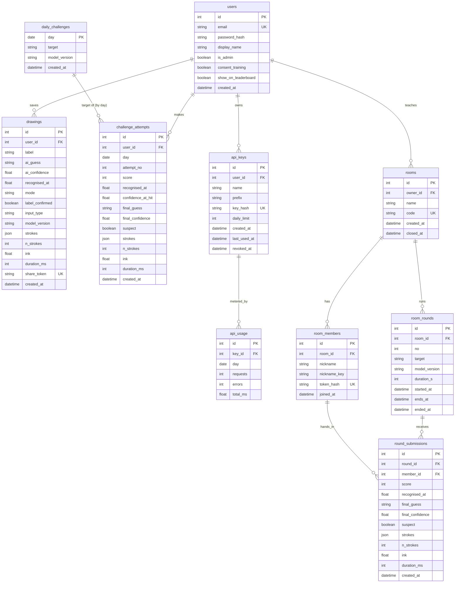

Notes: `drawings.strokes` is a list of strokes, each a list of `[x, y]` points in the 0 to 255 frame. `input_type` is `mouse`, `touch`, `pen` or null. API keys and room tokens are stored only as SHA-256 hashes; passwords as argon2 hashes. `daily_challenges` is linked to attempts by the `day` value, not by a declared foreign key.

### File-based artifacts

| File | Fields / format |
|---|---|
| `models/<v>/sketch.onnx` | Inputs `img` `[1,1,64,64]`, `seq` `[1,128,5]`, `length` `[1]`; outputs `probs` `[1, n_classes]` and `ghost` `[1,1,64,64]` (v3: 345 classes) |
| `models/<v>/meta.json` | `model`, `version`, `class_set`, `classes` (list), `img`, `max_pts`, `seq_feats`, `test_results`, `latency_ms`, `size_mb` (v1 has no `class_set`) |
| `models/<v>/results.json` | per completion fraction `"0.1"`..`"1.0"`: `top1`, `top5`, `ghost_bce` (v3 also `per_class_top1`); the v1 file is keyed by model name first |
| `models/<v>/samples.json` | list of `{label, strokes}`: real held-out sketches used by the demos and tests |
| `models/registry.json` | `schema`, `active`, `versions{<v>: class_set, n_classes, sha256, created, parent, architecture, size_mb, latency_ms, notes, metrics, checkpoint}`, `history` |
| `training.jsonl` (export) | one JSON object per line: `uid` (one-way hash, no identity), `label`, `strokes`, `source`, `input_type`, `model_version`, `created` |
| `data/processed/` (git-ignored) | pickle form `sketches.pkl` (v1) or packed form: concatenated `uint8` `(N,3)` point arrays plus per-drawing lengths, memory-mapped |
| `runs/flywheel/<run>/state.json` | the cycle's step log (for `--resume`) |
| `docs/results/gate_*.json`, `docs/results/loadtest.json` | promotion comparisons and load-test output |

### Request and response contracts (compact)

```text
POST /api/v1/predict            Authorization: Bearer <key>  (or X-API-Key)
  request : { strokes: [[ [x, y], ... ], ...], top_k: 1..10 (default 5) }
  response: { model: str, ink: float, predictions: [{ label: str, probability: float }], inference_ms: float }

Error (every endpoint): { "error": { "code": str, "message": str, "details"?: any } }

WebSocket /api/v1/rooms/{id}/live
  teacher: session cookie            student: first message { "token": "<room token>" }
  server pushes the full room state to every client after each change

Student calls send header  X-Room-Token: <token>   (POST /rooms/{id}/submit)
```

### Browser storage

| Key | Where | Content |
|---|---|---|
| `prescribble.theme` | `localStorage` | `"dark"` or `"light"` |
| `prescribble.room.<roomId>` | `localStorage` | `{ token, nickname }` so a student can reload mid-round |
| `prescribble_session` | httpOnly cookie | signed session (JavaScript cannot read it); `SameSite=Lax`, `Secure` in production |

---

## 11. API reference

Base path `/api/v1` (interactive reference at `/api/docs`). Health check: `GET /healthz`.

| Method and path | Purpose |
|---|---|
| `POST /auth/register`, `POST /auth/login`, `POST /auth/logout`, `GET /auth/session` | Account and session |
| `GET /me`, `PATCH /me`, `GET /me/export`, `DELETE /me`, `GET /me/stats` | Profile, data export, account deletion, personal stats |
| `POST /drawings`, `GET /drawings`, `GET /drawings/{id}`, `PATCH /drawings/{id}`, `DELETE /drawings/{id}` | Saved drawings |
| `POST /drawings/{id}/share`, `DELETE /drawings/{id}/share` | Create or remove a public link |
| `GET /public/drawings/{token}` | Read a shared drawing (no sign-in) |
| `GET /challenge/today`, `POST /challenge/attempts`, `GET /challenge/leaderboard`, `GET /challenge/me` | Daily challenge |
| `POST /keys`, `GET /keys`, `DELETE /keys/{id}`, `GET /keys/{id}/usage` | API keys and usage |
| `GET /model`, `GET /models`, `POST /predict` | Live model info, registered versions, prediction with a key |
| `POST /rooms`, `GET /rooms`, `POST /rooms/{id}/close`, `DELETE /rooms/{id}` | Teacher: manage rooms |
| `POST /rooms/{id}/rounds`, `POST /rooms/{id}/rounds/current/end` | Teacher: start or end a round |
| `GET /rooms/{id}/state`, `GET /rooms/{id}/rounds/{no}/drawings`, WebSocket `/rooms/{id}/live` | Room state, round drawings, live push |
| `POST /rooms/join`, `POST /rooms/{id}/submit` | Student: join with code and nickname, hand in a drawing |
| `GET /teach/summary`, `GET /teach/next`, `DELETE /teach/contributions` | Teach the AI |
| `GET /admin/metrics`, `POST /admin/model/reload` | Admin only |

---

## 12. Testing, limitations and ethics

**What is tested.** API (179 tests): authentication, ownership (other people's data answers 404), validation, rate limits, migrations up and down, security headers and the cross-site write check, backups and restore, classrooms, challenge scoring, model-version switching, consent rules for training data, and a test that fails if the documented API example differs from the live model. Engine, widget and web unit tests (6, 10 and 30). ML pipeline tests (60): partial-sketch geometry, the sampler fix, the registry and gate, the retraining cycle with a fake Kaggle. Browser tests (32, Playwright in real Edge) walk the full product including a teacher and two students in separate browser profiles, plus an axe-core scan against WCAG 2.1 A and AA in both themes.

**Capacity (one laptop, one process, rate limits raised; `docs/DEPLOY.md` section 6).** Prediction API about 17 to 20 predictions a second with a 95th percentile under 0.7 s; 60 students handing in at the same instant are all scored in about 20 s; 50 simultaneous daily-challenge attempts have a 95th percentile of 7.3 s; no errors in any scenario.

**Known limitations**

- 345 classes make each prediction harder than the 30-class model (66.1% for v3 on the original 30 classes' sketches when free to answer with any class).
- One run per model (no seeds).
- The object-detection experiment uses composed digit scenes, not sketches; the GAN is clearly worse than real digits.
- The ghost decoder is part of the exported network but no longer shown; its output was a blurry mean prediction.
- Best-effort anti-cheat only (implausibly fast drawings are kept off rankings); teachers cannot remove a student and there is no nickname filter.
- Single-process design: several replicas would split classroom rooms and rate limits (a Redis fan-out is not built).

**Privacy and ethics**

- Inference runs in the visitor's browser; the server stores a drawing only when the user saves or submits it. The widget sends nothing out (asserted by a network-log test).
- Training use is **opt-in**, off by default, requires a label the person confirmed, strips identity from exports (one-way `uid`), and can be withdrawn in one click. Classroom drawings are never training data; students have no account and gave no consent.
- Passwords are hashed with argon2; sessions are httpOnly cookies; API keys are shown once and stored hashed. Details: [`docs/SECURITY.md`](docs/SECURITY.md).
- QuickDraw data is CC BY 4.0; its drawings were contributed by players of Google's game.

---

## 13. References

**Data**

- Google Creative Lab. *The Quick, Draw! Dataset* (CC BY 4.0). <https://github.com/googlecreativelab/quickdraw-dataset>
- LeCun, Cortes, Burges. *The MNIST database of handwritten digits.*
- Maas et al. (2011). *Learning Word Vectors for Sentiment Analysis* (IMDB reviews). ACL.

**Methods**

- Hochreiter, Schmidhuber (1997). *Long Short-Term Memory.* Neural Computation.
- Kingma, Welling (2014). *Auto-Encoding Variational Bayes.* ICLR.
- Goodfellow et al. (2014). *Generative Adversarial Nets.* NeurIPS.
- Radford, Metz, Chintala (2016). *Unsupervised Representation Learning with Deep Convolutional GANs.* ICLR.
- Simonyan, Zisserman (2015). *Very Deep Convolutional Networks for Large-Scale Image Recognition* (VGG). ICLR.
- He et al. (2016). *Deep Residual Learning for Image Recognition.* CVPR.
- Redmon et al. (2016). *You Only Look Once: Unified, Real-Time Object Detection.* CVPR.
- Rezatofighi et al. (2019). *Generalized Intersection over Union.* CVPR.
- Loshchilov, Hutter (2019). *Decoupled Weight Decay Regularization* (AdamW). ICLR.
- Smith, Topin (2019). *Super-Convergence: Very Fast Training Using Large Learning Rates* (one-cycle schedule).
- Szegedy et al. (2016). *Rethinking the Inception Architecture* (label smoothing). CVPR.

**Libraries**: PyTorch, torchvision, ONNX and ONNX Runtime (Python and Web), NumPy, OpenCV, Matplotlib, Ultralytics YOLOv8, FastAPI, SQLAlchemy, Alembic, Pydantic, argon2-cffi, React, Vite, Vitest, Playwright, axe-core.

**More documentation:** [`docs/DEVELOPMENT.md`](docs/DEVELOPMENT.md) · [`docs/FLYWHEEL.md`](docs/FLYWHEEL.md) · [`docs/CLASSROOMS.md`](docs/CLASSROOMS.md) · [`docs/SECURITY.md`](docs/SECURITY.md) · [`docs/DEPLOY.md`](docs/DEPLOY.md) · [`docs/LAB.md`](docs/LAB.md) · [`docs/PRODUCT_PLAN.md`](docs/PRODUCT_PLAN.md) · [`report/REPORT.md`](report/REPORT.md) · [`report/SYLLABUS.md`](report/SYLLABUS.md) · [`report/GENERATIONS.md`](report/GENERATIONS.md)

---

<div align="center">

Deep Learning Laboratory Project · Faculty of Engineering and Technology, GLS University · Data: Google QuickDraw (CC BY 4.0)

</div>
