# Evaluation of the model generations (v1, v2, v3)

Generated by `python -m src.eval.model_report` from the shipped ONNX files, so it measures the models the app actually serves. Nothing in this file is typed by hand; the raw numbers are in `docs/results/evaluation.json`.

## 1. What was measured and how

* **Test sketches.** The first 25 of the 50 held-out QuickDraw drawings per class in `data/processed/v3/heldout.pkl`. They come from a slice of every class that none of v1, v2 or v3 trained on, so the three models are scored on the **same unseen sketches**. Each model is scored on the sketches of its own classes: v1 750 sketches (30 classes), v2 2,500 sketches (100 classes), v3 8,625 sketches (345 classes).
* **Partial drawings.** Every sketch is cut at a fraction of its total ink length (10, 20, 30, 40, 50, 60, 75, 90 and 100%) and the model sees only that prefix, exactly as in the app.
* **Intervals** are 95% Wilson intervals. They reflect the *size of the test sample* only. They do **not** include the variation between training runs (one run per model).
* **Top-1 / Top-5**: the true class is the first / among the first five answers. **Macro** scores average over classes, so a rare failure in one class counts as much as in a common one.
* **Calibration**: does a stated confidence of 70% mean the answer is right 70% of the time? ECE (15 bins) is the average gap; NLL and Brier are proper scoring rules (lower is better).

## 2. Headline: each model on its own classes

Official numbers from each model's full held-out test split (`models/<v>/results.json`, written at the end of training). Top-1 / Top-5 in %.

| Ink drawn | v1 (30 classes) | v2 (100 classes) | v3 (345 classes) |
|---|---:|---:|---:|
| 10% | 35.9 / 77.6 | 15.6 / 46.0 | 7.7 / 24.3 |
| 20% | 57.9 / 90.6 | 33.4 / 70.1 | 20.4 / 48.7 |
| 30% | 68.1 / 94.3 | 45.7 / 79.7 | 30.6 / 62.3 |
| 50% | 77.1 / 97.0 | 57.5 / 88.5 | 44.1 / 75.7 |
| 75% | 86.9 / 98.6 | 73.5 / 94.3 | 63.2 / 89.3 |
| 100% | 91.6 / 98.8 | 78.8 / 95.5 | 72.0 / 93.2 |

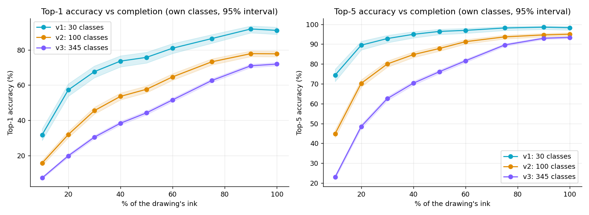

The same models re-scored on the common unseen sample (Top-1 / Top-5 with 95% interval, %):

| Ink drawn | v1 | v2 | v3 |
|---|---:|---:|---:|
| 10% | 31.7 / 74.4  (Top-5 71.2-77.4) | 15.7 / 44.8  (Top-5 42.9-46.8) | 7.2 / 23.0  (Top-5 22.1-23.9) |
| 20% | 57.2 / 89.5  (Top-5 87.1-91.5) | 31.8 / 70.2  (Top-5 68.4-72.0) | 19.8 / 48.5  (Top-5 47.4-49.5) |
| 30% | 67.6 / 92.8  (Top-5 90.7-94.4) | 45.4 / 80.0  (Top-5 78.4-81.5) | 30.4 / 62.6  (Top-5 61.5-63.6) |
| 40% | 73.6 / 94.9  (Top-5 93.1-96.3) | 53.6 / 84.7  (Top-5 83.3-86.1) | 38.3 / 70.3  (Top-5 69.3-71.3) |
| 50% | 75.7 / 96.4  (Top-5 94.8-97.5) | 57.6 / 87.8  (Top-5 86.5-89.0) | 44.2 / 76.1  (Top-5 75.2-77.0) |
| 60% | 80.9 / 96.9  (Top-5 95.4-97.9) | 64.6 / 91.2  (Top-5 90.1-92.3) | 51.6 / 81.6  (Top-5 80.8-82.4) |
| 75% | 86.4 / 98.1  (Top-5 96.9-98.9) | 73.2 / 93.6  (Top-5 92.6-94.5) | 62.6 / 89.6  (Top-5 88.9-90.2) |
| 90% | 91.9 / 98.5  (Top-5 97.4-99.2) | 77.8 / 94.6  (Top-5 93.7-95.5) | 71.0 / 93.0  (Top-5 92.4-93.5) |
| 100% | 91.1 / 98.3  (Top-5 97.1-99.0) | 77.8 / 95.0  (Top-5 94.1-95.8) | 71.9 / 93.4  (Top-5 92.8-93.9) |

Agreement with the official table: all official Top-5 figures lie inside the re-scored 95% interval except v1 Top-5 at 10%, v3 Top-5 at 10% (the re-scored sample is smaller, so its intervals are wider, and it is a different set of sketches).

More classes is a harder task, so these rows are not like for like. Section 3 compares them fairly.

## 3. Like for like: the 30 original classes

Sketches of the 30 original classes only (750 sketches). v1 knows only these. For v2 and v3 two views: **restricted** (they may answer only with the 30, which removes the advantage v1 has of a smaller choice) and **free** (they may answer with any class they know, the situation a real user is in).

Top-5 accuracy (%):

| Model | Answers allowed | 20% | 30% | 50% | 100% | mean of 20/30/50% |
|---|---|---:|---:|---:|---:|---:|
| v1 | only the 30 | 89.5 | 92.8 | 96.4 | 98.3 | 92.9 |
| v2 | restricted to the 30 | 87.9 | 92.0 | 95.9 | 97.6 | 91.9 |
| v2 | free (any of 100) | 68.9 | 78.4 | 87.5 | 93.2 | 78.3 |
| v3 | restricted to the 30 | 91.7 | 95.6 | 98.5 | 99.3 | 95.3 |
| v3 | free (any of 345) | 53.9 | 68.0 | 76.5 | 94.4 | 66.1 |

Top-1 accuracy (%):

| Model | Answers allowed | 20% | 30% | 50% | 100% |
|---|---|---:|---:|---:|---:|
| v1 | only the 30 | 57.2 | 67.6 | 75.7 | 91.1 |
| v2 | restricted to the 30 | 54.5 | 65.3 | 74.7 | 87.9 |
| v2 | free (any of 100) | 33.9 | 46.3 | 55.7 | 76.7 |
| v3 | restricted to the 30 | 59.9 | 71.2 | 82.1 | 93.7 |
| v3 | free (any of 345) | 24.0 | 35.3 | 48.4 | 74.9 |

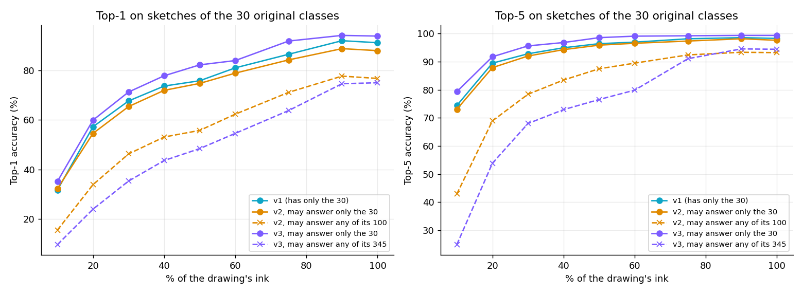

**v2 vs v3 on the 100 classes they share** (2500 sketches, both restricted to those 100; Top-5 mean of 20/30/50%): v2 79.3%, v3 85.3%.

## 4. Precision, recall and F1 (macro)

| Ink drawn | Model | Precision | Recall | F1 |
|---|---|---:|---:|---:|
| 30% of the ink | v1 | 68.4 | 67.6 | 67.1 |
| 30% of the ink | v2 | 46.0 | 45.4 | 44.9 |
| 30% of the ink | v3 | 31.4 | 30.4 | 29.3 |
| finished drawing | v1 | 91.2 | 91.1 | 90.9 |
| finished drawing | v2 | 79.1 | 77.8 | 77.5 |
| finished drawing | v3 | 73.0 | 71.9 | 71.0 |

Recall equals the mean per-class Top-1 accuracy. Where precision falls below recall a model over-uses some classes (answers them too often); where recall falls below precision it under-uses some.

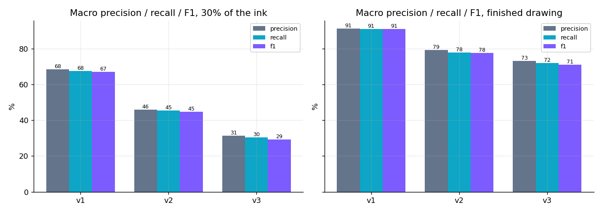

## 5. Calibration

| Ink drawn | Model | Top-1 accuracy % | Mean confidence % | Verdict | ECE | NLL | Brier |
|---|---|---:|---:|---|---:|---:|---:|
| 30% of the ink | v1 | 67.6 | 71.3 | over-confident | 0.055 | 1.128 | 0.451 |
| 30% of the ink | v2 | 45.4 | 53.3 | over-confident | 0.079 | 2.035 | 0.709 |
| 30% of the ink | v3 | 30.4 | 28.1 | under-confident | 0.031 | 2.823 | 0.825 |
| finished drawing | v1 | 91.1 | 89.1 | close | 0.031 | 0.350 | 0.137 |
| finished drawing | v2 | 77.8 | 79.8 | close | 0.027 | 0.786 | 0.308 |
| finished drawing | v3 | 71.9 | 63.5 | under-confident | 0.084 | 1.033 | 0.395 |

Verdict: **over-confident** when mean confidence exceeds accuracy by more than 2 points, **under-confident** when it falls short by more than 2 points. NLL and Brier cannot be compared across models with different numbers of classes.

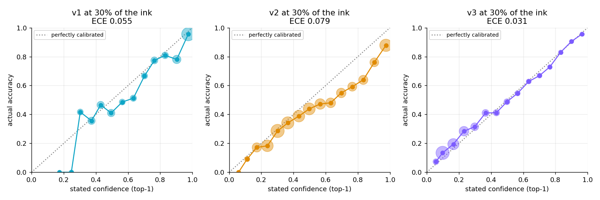

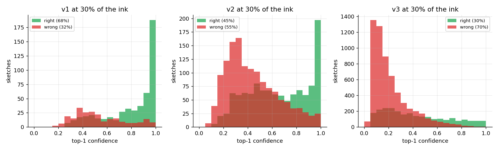

## 6. How early is the answer right?

Share of sketches whose top-1 answer is already right by a given amount of ink (%), the median ink needed for the first right answer (among sketches that get one), and the share never reliably right from some point to the end:

| Model | right by 20% | right by 30% | right by 50% | median ink for first right | never right to the end % |
|---|---:|---:|---:|---:|---:|
| v1 | 60.9 | 74.3 | 86.3 | 20% | 8.9 |
| v2 | 36.7 | 54.4 | 72.8 | 30% | 22.2 |
| v3 | 21.4 | 34.9 | 54.0 | 40% | 28.1 |

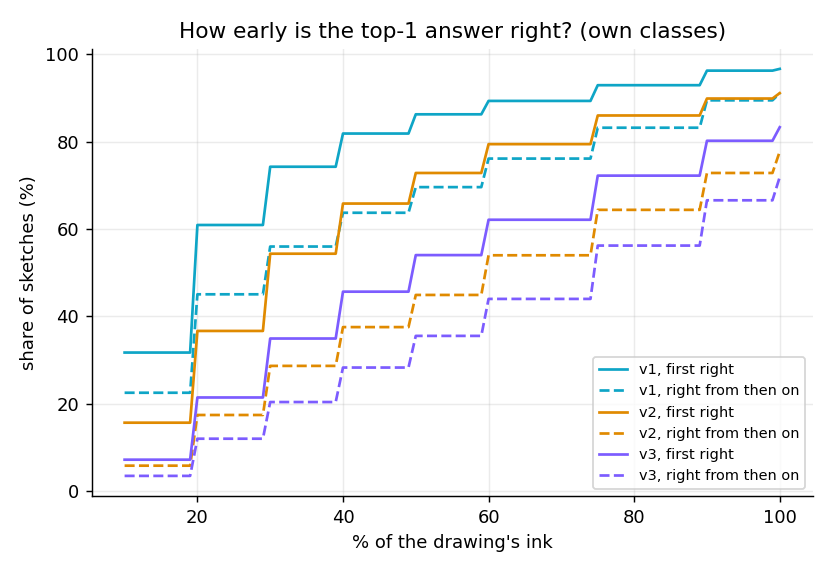

## 7. Per class

Per-class Top-1 accuracy. Each class has 25 test sketches, so a per-class figure moves in steps of 4 points: read the **distribution**, not single classes.

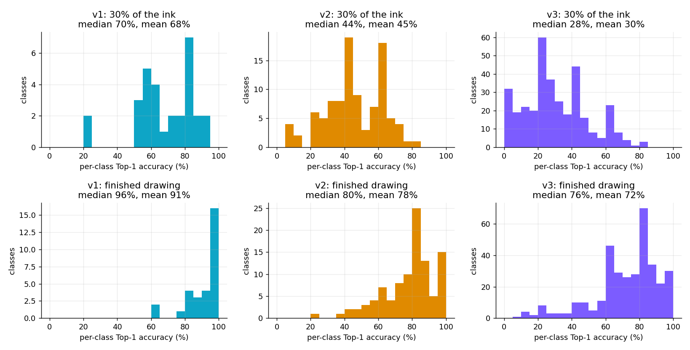

**v1** (30 classes): median 96% finished, 70% at 30% of the ink; 20 classes at or above 90%, 0 below 30% (finished).  
Easiest: ice cream (100%), guitar (100%), coffee cup (100%), house (100%), bicycle (100%), apple (100%), envelope (96%), airplane (96%), tree (96%), car (96%).  
Hardest: bird (64%), moon (64%), fish (76%), cat (84%), clock (84%), dog (84%), key (84%), banana (88%), mushroom (88%), light bulb (88%).

**v2** (100 classes): median 80% finished, 44% at 30% of the ink; 20 classes at or above 90%, 1 below 30% (finished).  
Easiest: sailboat (100%), coffee cup (100%), guitar (100%), ladder (100%), house (100%), star (100%), envelope (100%), shoe (96%), skull (96%), wine glass (96%).  
Hardest: dog (24%), mountain (36%), bear (40%), bench (44%), bird (48%), bed (48%), light bulb (52%), moon (52%), bridge (52%), elephant (56%).

**v3** (345 classes): median 76% finished, 28% at 30% of the ink; 52 classes at or above 90%, 18 below 30% (finished).  
Easiest: The Mona Lisa (100%), crown (100%), ladder (100%), tornado (100%), sailboat (100%), stop sign (100%), harp (100%), parachute (100%), star (100%), helicopter (96%).  
Hardest: garden hose (8%), mouse (12%), line (12%), cooler (12%), bear (12%), aircraft carrier (16%), marker (16%), hurricane (20%), potato (20%), leg (20%).

## 8. What the models confuse

At 30% of the ink, the most common wrong answers (true class -> predicted class, number of sketches):

* **v1**: smiley face -> clock (11); moon -> clock (7); clock -> moon (5); smiley face -> moon (4); key -> guitar (4); dog -> snowman (4); pizza -> clock (4); dog -> coffee cup (4)
* **v2**: tent -> mountain (11); clock -> moon (8); pants -> door (8); smiley face -> clock (8); zebra -> cow (7); pizza -> basketball (6); camera -> envelope (6); calculator -> door (6)
* **v3**: basketball -> soccer ball (11); hurricane -> tornado (10); sweater -> jacket (9); baseball -> clock (9); tent -> mountain (9); keyboard -> underwear (9); blueberry -> clock (8); remote control -> door (8)

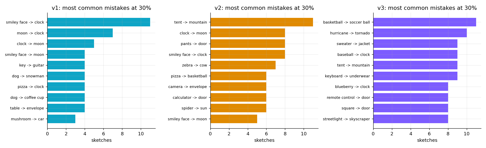

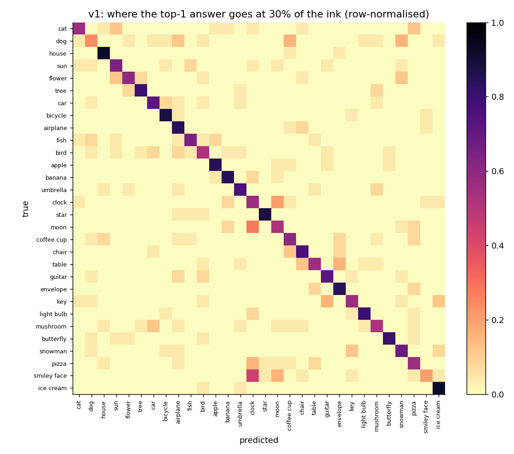

## 9. Cost

| Model | Architecture | Classes | Parameters | ONNX size | CPU time per prediction |
|---|---|---:|---:|---:|---:|
| v1 | fusion_ghost | 30 | 4.5 M | 17.9 MB | 4.8 ms |
| v2 | fusion_ghost | 100 | 4.5 M | 18.0 MB | 5.3 ms |
| v3 | fusion_ghost_xl | 345 | 8.6 M | 34.5 MB | 12.0 ms |

Parameters are counted from the ONNX file (they include the decoder head that the app no longer displays). Time per prediction is from `meta.json`, measured natively with ONNX Runtime on a CPU at export; in the browser v3 takes about 47 ms.

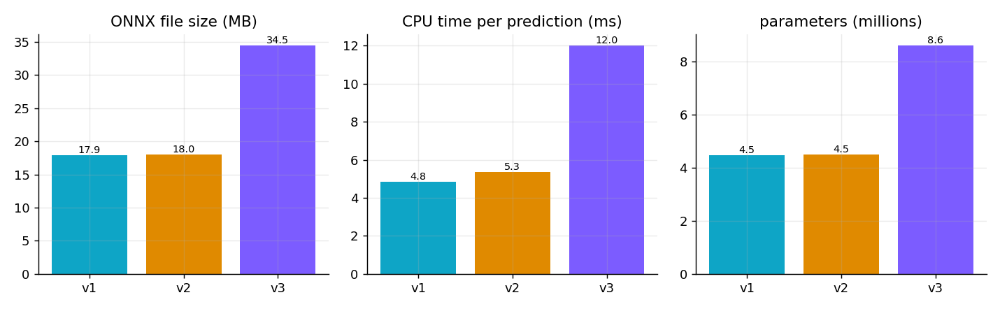

## 10. Training curves

Training loss and the validation score used to pick the best epoch (mean Top-1 over the six fractions on a validation split). The models have different numbers of classes and different run lengths, so the curves show each model's own convergence, not a ranking.

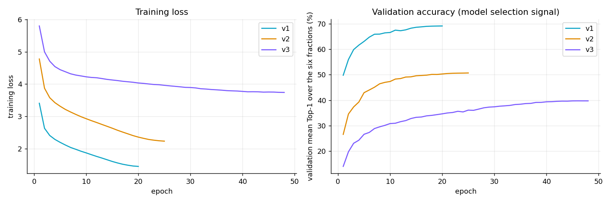

## 11. How to read these numbers

* The models are scored on held-out **QuickDraw** sketches (drawn on phones, cleaned by Google). Real mouse drawings differ, so expect lower accuracy for real users; this has not been measured.
* Each model is **one training run**; there are no seeds. Differences of about a point are within what another run could change.
* 25 sketches per class gives narrow aggregate intervals but coarse per-class figures. The official table in section 2 uses each model's full test split; section 2 states where it differs from the re-scored table.
* v1 and v2 were trained before a sampling bug was fixed (every epoch replayed the same samples); v3 was retrained after the fix. This lowers v1 and v2 somewhat, so the gap to v3 on shared classes may be larger than a fully corrected v1 / v2 would show. Details: `docs/FLYWHEEL.md`.
* More classes make a single prediction harder because look-alike classes compete (section 3, free vs restricted).

## Reproduce

```bash
python -m src.eval.score_models --per-class 25 --workers 3   # about 10 minutes on a laptop CPU
python -m src.eval.model_report
python -m pytest tests/test_eval_metrics.py -q
```
