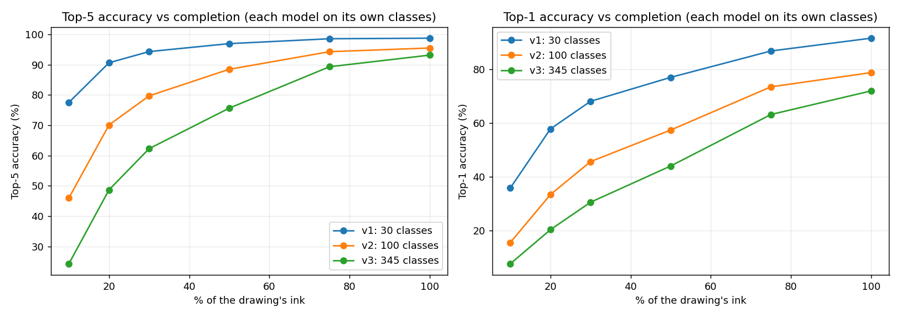
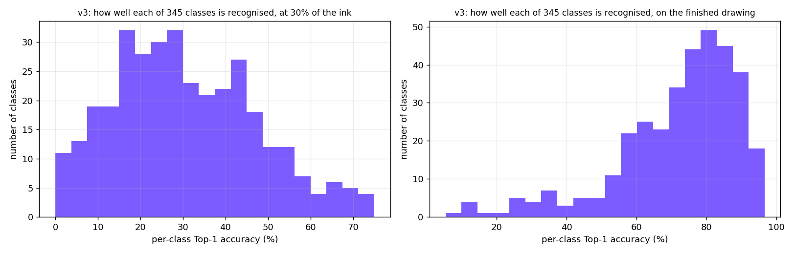

# Model generations

Each model is measured on held-out QuickDraw sketches of **its own** classes, so the rows are not like for like: more classes is a harder task. The like-for-like comparison on shared classes follows.

| Model | Classes | Top-5 at 20% | Top-5 at 30% | Top-5 finished | Top-1 at 30% | Top-1 finished | Size | Latency (CPU) |
|---|---:|---:|---:|---:|---:|---:|---:|---:|
| v1 (fusion_ghost) | 30 | 90.6 | 94.3 | 98.8 | 68.1 | 91.6 | 18 MB | 4.8 ms |
| v2 (fusion_ghost) | 100 | 70.1 | 79.7 | 95.5 | 45.7 | 78.8 | 18 MB | 5.3 ms |
| v3 (fusion_ghost_xl) | 345 | 48.7 | 62.3 | 93.2 | 30.6 | 72.0 | 34 MB | 12.0 ms |

**Shared-class comparison, v1 to v2** (900 held-out sketches, both models limited to the classes they share, Top-5 averaged over 20 / 30 / 50% of the ink): live model 92.8%, candidate 91.9% (difference -0.9 points); the candidate choosing among all its own classes: 78.0%.

**Shared-class comparison, v1 to v3** (900 held-out sketches, both models limited to the classes they share, Top-5 averaged over 20 / 30 / 50% of the ink): live model 92.8%, candidate 95.4% (difference +2.6 points); the candidate choosing among all its own classes: 66.1%.

**Shared-class comparison, v2 to v3** (3000 held-out sketches, both models limited to the classes they share, Top-5 averaged over 20 / 30 / 50% of the ink): live model 79.4%, candidate 85.2% (difference +5.8 points); the candidate choosing among all its own classes: 67.4%.

## v3: which classes work

**Easiest classes**

| Class | Top-1 finished | Top-1 at 30% |
|---|---:|---:|
| ladder | 96.7 | 68.0 |
| The Mona Lisa | 96.7 | 19.3 |
| star | 95.7 | 72.7 |
| envelope | 95.0 | 20.7 |
| stop sign | 95.0 | 24.3 |
| pineapple | 94.7 | 67.7 |
| sailboat | 94.3 | 64.7 |
| The Eiffel Tower | 94.3 | 62.7 |
| octopus | 94.0 | 56.3 |
| angel | 94.0 | 57.3 |
| skull | 93.7 | 48.3 |
| helicopter | 93.3 | 34.3 |

**Hardest classes**

| Class | Top-1 finished | Top-1 at 30% |
|---|---:|---:|
| line | 5.3 | 53.0 |
| cooler | 10.7 | 0.0 |
| bear | 10.7 | 9.0 |
| marker | 13.3 | 2.0 |
| mouse | 14.0 | 1.7 |
| garden hose | 16.7 | 3.7 |
| dog | 22.3 | 7.0 |
| potato | 23.7 | 13.7 |
| aircraft carrier | 24.0 | 4.7 |
| diving board | 27.0 | 6.3 |
| hurricane | 27.7 | 29.3 |
| circle | 28.0 | 34.0 |

34 of 345 classes reach 90% Top-1 on the finished drawing, 311 reach 50%, and 12 stay below 30%.
