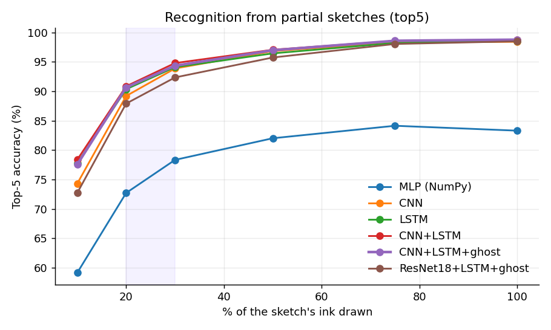
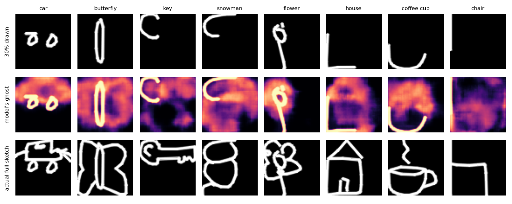
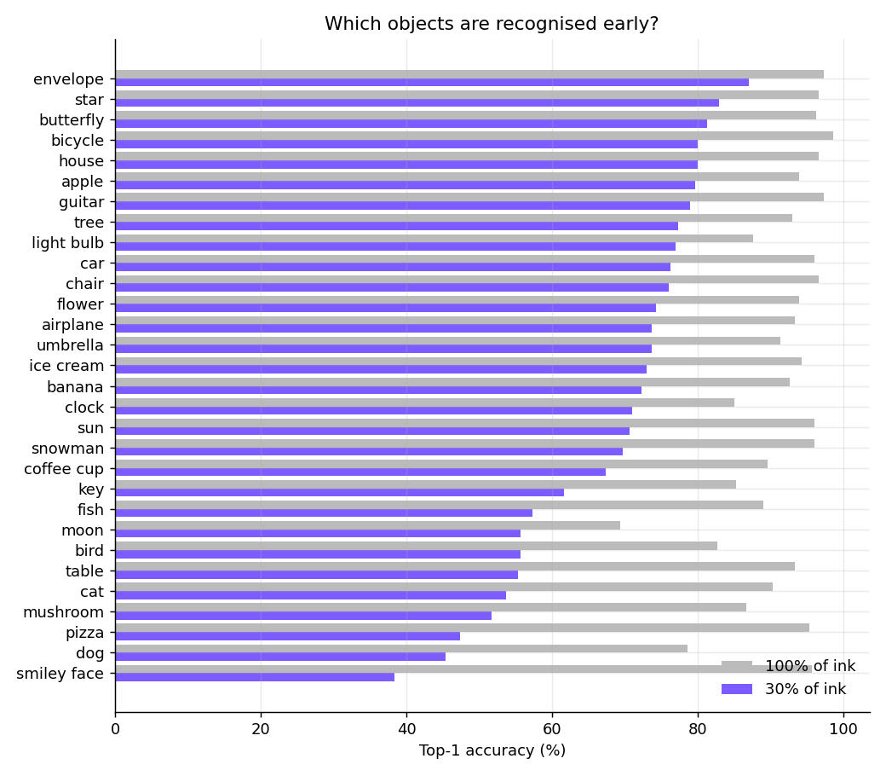

# Sketch Evolution Predictor: report

*Deep Learning Laboratory (2604733), GLS FET B.Tech CS&E, Semester VII.*
All numbers below are generated from the training runs and the held-out test split (9,000 sketches, 300 per class, never used for training or model selection).

## 1. Problem
Given only the first part of a drawing, predict what the final drawing will be. The system reads the pen strokes as they are drawn and
(a) ranks the **Top-5 object classes**, and (b) paints a **ghost** of how it expects the drawing to end. Everything runs live in a web browser.

## 2. Data
Google QuickDraw (CC BY 4.0), stroke-level "simplified" files, **30 classes** (cat, dog, house, sun, flower, tree, car, bicycle, airplane, fish, bird, apple, banana, umbrella, clock, star, moon, coffee cup, chair, table, guitar, envelope, key, light bulb, mushroom, butterfly, snowman, pizza, smiley face, ice cream).
96,000 training / 9,000 validation / 9,000 test sketches. Stroke data is essential: bitmaps cannot be cut at "30% of the drawing".

**Partial sketches.** Each drawing is cut at a fraction of its total *ink length* (not stroke count, since many sketches have 2 to 4 strokes), so the cut may fall mid-stroke.
Training draws the fraction at random (half of the samples from 12 to 40%, the rest from 10 to 100%) and augments the whole drawing (flip, rotation, scale, shift, jitter) *before* cutting.
Evaluation uses fixed fractions: 10, 20, 30, 50, 75 and 100%.

**Fixed frame.** QuickDraw rescales a finished drawing to fill a 256x256 box, but a live user's unfinished drawing has no final bounding box.
The prefix is therefore cut from the already-normalised drawing and is **not** re-normalised, and the canvas uses the same fixed frame.

## 3. Models (mapped to the course modules)
| Module | Component | Where |
|---|---|---|
| I: NN, MLP, backprop, MNIST | MLP with manual backpropagation in NumPy (verified against numerical gradients). MNIST test accuracy **97.85%**. Reused as the sketch baseline. | `src/models/mlp_numpy.py`, `src/train/mlp_baseline.py` |
| II: Autoencoders | Conv decoder ("ghost") trained jointly to reconstruct the *completed* drawing from the partial one (encoder-decoder with a skip from the input). | `GhostDecoder` in `src/models/nets.py` |
| III: CNN | 3-stage CNN with BatchNorm on 64x64 rasters. | `CNNEncoder` |
| IV: RNN / LSTM | 2-layer LSTM over the stroke points (x, y, dx, dy, new-stroke flag). Sentiment analysis: LSTM on IMDB, test accuracy **85.67%**. | `LSTMEncoder`, `src/train/sentiment_lstm.py` |
| V: Transfer learning | ImageNet-pretrained ResNet18 (1-channel adaptation) fused with the LSTM, fine-tuned end to end. | `ResNetEncoder` |

Final model: CNN branch + LSTM branch, concatenated, feeding a classifier head and the ghost decoder. Loss = cross-entropy (label smoothing 0.05) + ghost reconstruction loss (BCE). 4.5M parameters.
Training ran on a Kaggle GPU (`kaggle/`); evaluation, export and the demo run on a CPU.

## 4. Results
### Top-5 accuracy vs % of the sketch drawn (test set)
| Model | 10% | 20% | 30% | 50% | 75% | 100% |
|---|---:|---:|---:|---:|---:|---:|
| MLP (NumPy, from scratch) | 59.1 | 72.7 | 78.3 | 82.0 | 84.1 | 83.3 |
| CNN | 74.3 | 89.2 | 93.9 | 96.8 | 98.3 | 98.4 |
| LSTM (stroke sequence) | 77.8 | 90.3 | 94.1 | 96.4 | 98.2 | 98.5 |
| CNN + LSTM fusion | **78.4** | **90.8** | **94.8** | **97.1** | 98.6 | **98.8** |
| CNN + LSTM + ghost decoder (**deployed**) | 77.6 | 90.6 | 94.3 | 97.0 | **98.6** | **98.8** |
| ResNet18 (ImageNet) + LSTM + ghost | 72.7 | 87.9 | 92.3 | 95.7 | 98.0 | 98.5 |

### Top-1 accuracy
| Model | 10% | 20% | 30% | 50% | 75% | 100% |
|---|---:|---:|---:|---:|---:|---:|
| MLP (NumPy, from scratch) | 20.2 | 32.7 | 40.3 | 44.5 | 49.2 | 49.7 |
| CNN | 33.0 | 54.9 | 66.4 | 75.1 | 85.7 | 89.8 |
| LSTM (stroke sequence) | 35.2 | 55.8 | 67.3 | 74.7 | 84.2 | 88.3 |
| CNN + LSTM fusion | 35.4 | **58.1** | **68.2** | 76.5 | **87.3** | 90.7 |
| CNN + LSTM + ghost decoder (**deployed**) | **35.9** | 57.9 | 68.1 | **77.1** | 86.9 | **91.6** |
| ResNet18 (ImageNet) + LSTM + ghost | 31.8 | 53.9 | 65.3 | 75.5 | 86.7 | 91.3 |

**Headline.** With only **20%** of the ink the deployed model has the right answer in its Top-5 **90.6%** of the time, and **94.3%** at 30%
(Top-1: 57.9% and 68.1%). With the full sketch it reaches 98.8% Top-5 and 91.6% Top-1.

**What the ablation shows.**
* The from-scratch **MLP** is far behind (78.3% Top-5 at 30%): it ignores spatial structure.
* The **CNN** and the **LSTM** are close to each other, and **fusing** them gives the best result at every completion level (the two fused variants, with and without the ghost head, trade first place), especially early, when the two views (appearance and stroke order) complement each other.
* Adding the **ghost decoder** leaves classification essentially unchanged (94.3% vs 94.8% Top-5 at 30%, within noise) while adding the completion feature.
* **Transfer learning did not help here.** Swapping the small from-scratch CNN for an ImageNet ResNet18 (everything else identical) gives 91.3% Top-1 on full sketches versus 91.6%, i.e. no gain, and it is clearly behind early on (87.9% vs 90.6% Top-5 at 20%). Line drawings are far from natural photographs, and the heavier network is slower (about 130 s per epoch vs 55 s on the GPU).

### Ghost completion

The ghost is a *mean* prediction (an expected-ink heat map), not a sharp drawing: when the object is ambiguous it blends the plausible endings. That is intended. Its blurriness is a visible measure of the model's uncertainty. In the demo only the *not yet drawn* part is shown.

### Which objects are recognised early?

At 30% of the ink the easiest classes are envelope (87%), star (83%), butterfly (81%) and the hardest are smiley face (38%), dog (45%), pizza (47%) (Top-1).
The most common confusions at 30% are smiley face to clock (117), pizza to clock (81), moon to clock (77), table to envelope (71), clock to moon (45): many drawings start as a circle, which is genuinely ambiguous.

## 5. Real-time system
* Model exported to ONNX (17.9 MB), verified against PyTorch (max difference about 1e-7).
* Inference: **4.8 ms** per prediction in native ONNX Runtime on a CPU, about 17 to 20 ms in the browser (WebAssembly), so it updates on every pen movement.
* The page runs entirely client-side: no server-side model, no internet, no GPU. A static Python server (`apps/web/serve.py`) is all a lab machine needs.
* The browser reproduces the Python preprocessing: the stroke-sequence features match exactly, and the rasteriser's mean pixel difference to the training renderer is under 0.01.

## 6. Limitations (honest)
* Test accuracy is on **held-out QuickDraw sketches**. Live drawings with a mouse differ from the phone/touch drawings in QuickDraw. This domain shift was only sanity-checked with scripted pointer input, **not** measured in a user study, so expect lower accuracy for real users, especially for very small or off-centre drawings.
* Only 30 classes. More classes would lower early accuracy.
* The ghost is blurry by construction (mean prediction); a VAE or GAN could give sharper, multi-modal completions. VAE and GAN were built and measured on MNIST (see SYLLABUS.md) but not applied to sketch completion.
* A single training run per model (no seeds / confidence intervals); differences of about 1 point between the CNN, LSTM and fusion models should not be over-interpreted.
* Object detection (YOLO) was done on composed digit scenes, not on the sketch app itself (see SYLLABUS.md).

## 7. Reproduce
See the README. Training scripts: `src/train/train.py`; Kaggle driver: `kaggle/kernel/train_kaggle.py`.
