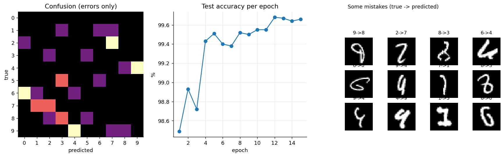
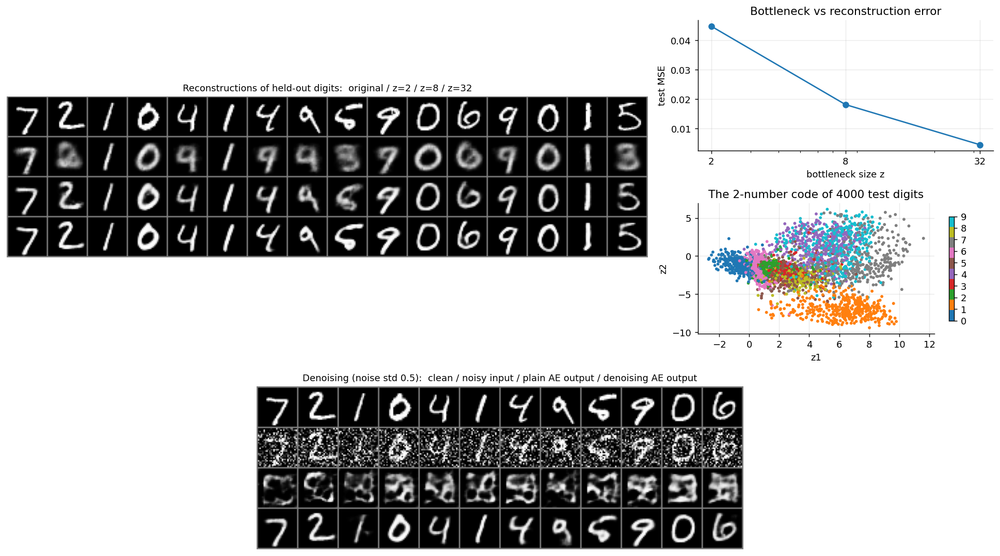
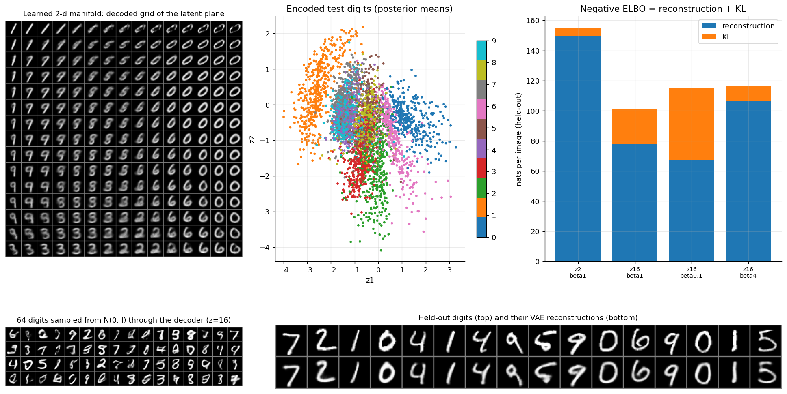
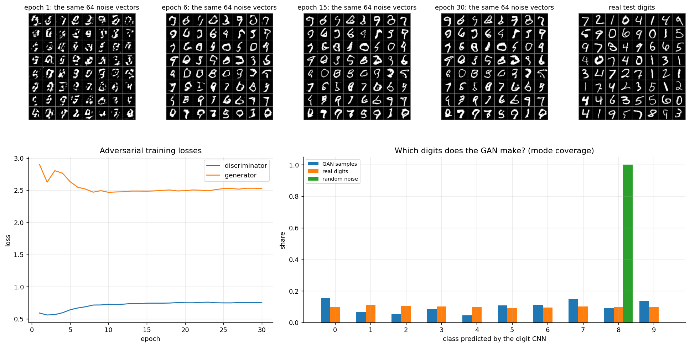
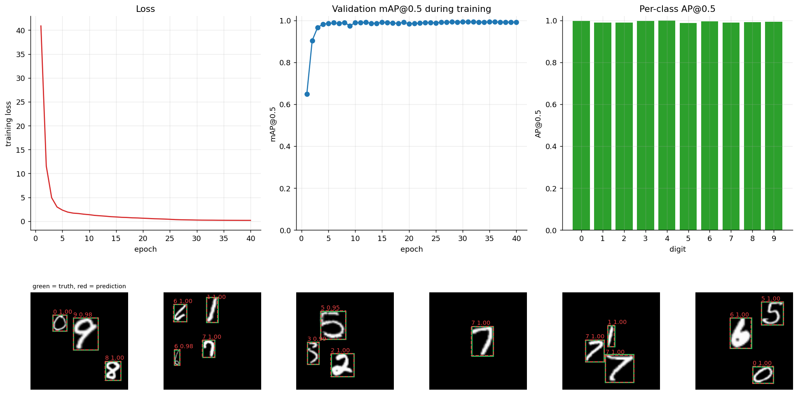
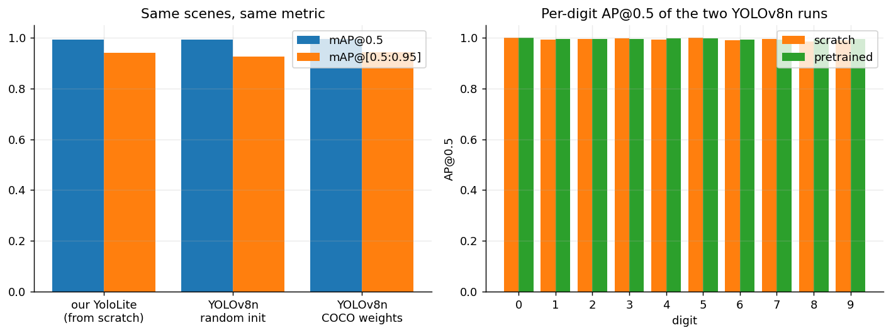
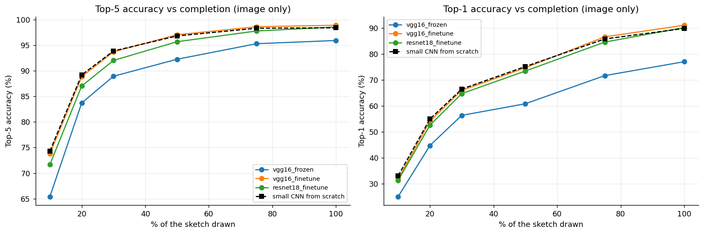

# Syllabus experiments: closing the Module II, III and V gaps

The main project (see [REPORT.md](REPORT.md)) covers Modules I and IV and parts of II, III and V. These experiments add what was missing: a **CNN on digits, convolutional autoencoder, VAE, GAN, object detection (YOLO, from scratch and transfer) and VGG transfer learning**. Everything was trained on a Kaggle GPU in one session (62 min of compute in total; per step: digit_cnn 86 s, ae 67 s, vae 115 s, gan 2 min, det_scratch 11 min, det_yolov8 26 min, vgg 17 min) by `kaggle/syllabus/run_syllabus.py`; the numbers below are read from `report/syllabus_results/` by `src/syllabus/report.py`. Each experiment is one run (seed 0): there are no confidence intervals.

## Module III: CNN digit classification (MNIST)
A CNN with two 3x3 conv blocks per resolution (28 to 14 to 7), batch norm, dropout and light random affine augmentation, 468,010 parameters, 15 epochs (`src/syllabus/digit_cnn.py`).

| Model | Test accuracy | Errors / 10,000 |
|---|---:|---:|
| NumPy MLP, from scratch (Module I) | 97.85% | 215 |
| **CNN** | **99.66%** | **34** |

The CNN removes about 84% of the MLP's errors with the same data: convolution shares weights across positions and pooling gives tolerance to small shifts, which a dense network has to learn from examples. The weakest digit is **6** (99.48%).



## Module II: autoencoders, VAE and GAN (all on MNIST)

### Convolutional autoencoder (`src/syllabus/ae.py`)
Encoder 28 to 14 to 7 to a z-vector, mirrored transposed-convolution decoder, binary cross-entropy loss, 15 epochs.

| Bottleneck z | Compression | Held-out MSE |
|---|---:|---:|
| 2 | 392.0x | 0.0448 |
| 8 | 98.0x | 0.0182 |
| 32 | 24.5x | 0.0045 |

Reconstruction error falls steadily as the code grows. With a 2-number code only a few classes (such as 0 and 1) separate cleanly in the code plane and the reconstructions are blurry blobs of the right general shape (figure); 8 numbers keep most of the stroke shape.
**Denoising:** with Gaussian noise (std 0.5) on the input only, the denoising AE (z=32) reaches MSE **0.0119** against the clean image, the plain z=32 AE 0.0890, and the noisy image itself 0.1157: the plain AE, trained only on clean digits, improves its noisy input only a little by MSE and its output is visibly garbled (figure), while the denoising AE learns what a digit looks like and removes most of the noise.



### Variational autoencoder (`src/syllabus/vae.py`)
Same architecture with a (mu, log-variance) head, the reparameterisation trick and loss = reconstruction + beta x KL. Values are nats per held-out image; the negative ELBO (reconstruction + KL, at beta = 1) is the quantity a VAE minimises.

| z | beta | Reconstruction | KL | Reconstruction + KL | Active dims |
|---|---:|---:|---:|---:|---:|
| 2 | 1.0 | 149.2 | 5.9 | **155.1** | 2 / 2 |
| 16 | 1.0 | 77.6 | 23.9 | **101.5** | 16 / 16 |
| 16 | 0.1 | 67.5 | 47.5 | **114.9** | 16 / 16 |
| 16 | 4.0 | 106.4 | 10.2 | **116.7** | 16 / 16 |

Among the 16-d models the beta = 1 objective is the one the ELBO defines, and its reconstruction + KL (101.5) is the lowest, as it should be since it optimises exactly that. A smaller beta buys sharper reconstructions (lower reconstruction term) by letting the code carry more information (higher KL); a larger beta forces a simpler, smoother code at the cost of blurrier digits. The 2-d model's manifold (figure) shows digits morphing smoothly between classes, and decoding random N(0, I) vectors gives new digits, which a plain autoencoder cannot do.



### GAN (`src/syllabus/gan.py`)
DCGAN (transposed-conv generator, strided-conv discriminator, non-saturating generator loss, one-sided label smoothing), 30 epochs. Judged with the digit CNN above, since FID is built on ImageNet features:

| Images | Classifier confidence | Class entropy (max 2.303) | Inception-style score (max 10) |
|---|---:|---:|---:|
| Real test digits | 0.956 | 2.301 | 7.75 |
| **GAN samples (10,000)** | **0.743** | **2.233** | **3.84** |
| Uniform random noise | 1.000 | 0.000 | 1.00 |

All ten digits appear (entropy 2.23 of a possible 2.30, so no mode collapse), but the mix is uneven (digit 0 makes up 15.4% of samples, digit 4 only 4.6%) and the samples are clearly less recognisable than real digits (confidence 0.74 versus 0.96; score 3.8 versus 7.7). The noise row shows why confidence alone is a poor metric: the classifier is 100% confident that noise is a single digit, which is why coverage and the combined score are reported too.



## Module III and V: object detection (YOLO)
**Task.** 128x128 scenes with 1 to 4 real MNIST digits of different sizes at random places (20,000 training scenes from the MNIST training digits; 2,000 validation scenes with 4,989 objects, composed from the MNIST *test* digits so no digit is shared). Boxes are measured from the pasted pixels, so labels are exact (`src/syllabus/detection/scenes.py`).

**Detector from scratch** (`yolo_lite.py`): a stride-8 backbone, a 16x16 grid, and per cell an objectness logit, a box and 10 class logits. Targets go to the cell holding the box centre; loss = BCE objectness + 5 x (1 - GIoU) + cross-entropy; decoding = objectness x class probability, a confidence threshold and per-class NMS. **Metric** (`metrics.py`): IoU, VOC all-point average precision, mAP@0.5 and mAP@[0.5:0.95], written without a library and unit-tested on hand-worked cases. All three detectors are scored by this one implementation on the same scenes (the last column is Ultralytics' own, COCO-style, number for reference).

| Detector | mAP@0.5 (%) | mAP@[0.5:0.95] (%) | Ultralytics mAP@[0.5:0.95] (%) |
|---|---:|---:|---:|
| YoloLite, written from scratch (441,023 params, 40 epochs) | 99.31 | 94.10 | n/a |
| YOLOv8n, random init (3,012,798 params, 30 epochs) | 99.39 | 92.69 | 94.63 |
| YOLOv8n, COCO-pretrained, fine-tuned (30 epochs) | 99.59 | 94.41 | 96.14 |




**Reading the numbers honestly.** Transfer learning moved mAP@0.5 by +0.20 points and mAP@[0.5:0.95] by +1.72 points over the same YOLOv8n trained from random weights, and the from-scratch YoloLite (15% of YOLOv8n's size) is within a point of both. Digits on a black canvas are an easy detection problem, so every model is near the ceiling and **this experiment cannot separate them**; a single training run per model gives no error bars, so differences this small should not be over-interpreted. What it does show is that the whole detection pipeline (assignment, loss, decoding, NMS, metric) is correct: an independently implemented detector and Ultralytics agree. The localisation-strict metric (mAP@[0.5:0.95]) is where the models differ most. COCO-pretrained weights are for photographs of 80 object classes, so little of what they know applies here beyond generic edge and shape features.

## Module V: transfer learning with VGG16 (and ResNet18, controlled)
All models see only the 64x64 raster, with the same training stream and evaluation as the main experiments, 8 epochs (`src/syllabus/vgg_transfer.py`). ImageNet weights, one channel replicated to three. `frozen` trains only a new classifier on VGG16's convolutional features; `finetune` trains every layer at a lower learning rate.

**Top-5 accuracy (%) by share of the sketch drawn**

| Model (image only) | Trained params | 10% | 20% | 30% | 50% | 75% | 100% |
|---|---:|---:|---:|---:|---:|---:|---:|
| Small CNN from scratch (existing) | n/a | 74.3 | 89.2 | 93.9 | 96.8 | 98.3 | 98.4 |
| vgg16_frozen | 532,254 | 65.4 | 83.7 | 88.9 | 92.3 | 95.3 | 95.9 |
| vgg16_finetune | 15,246,942 | 73.8 | 88.8 | 93.7 | 97.0 | 98.6 | 98.9 |
| resnet18_finetune | 11,315,550 | 71.7 | 87.0 | 92.0 | 95.7 | 97.8 | 98.6 |

**Top-1 accuracy (%)**

| Model (image only) | Trained params | 10% | 20% | 30% | 50% | 75% | 100% |
|---|---:|---:|---:|---:|---:|---:|---:|
| Small CNN from scratch (existing) | n/a | 33.0 | 54.9 | 66.4 | 75.1 | 85.7 | 89.8 |
| vgg16_frozen | 532,254 | 25.0 | 44.7 | 56.3 | 60.8 | 71.6 | 77.0 |
| vgg16_finetune | 15,246,942 | 31.8 | 54.1 | 65.9 | 74.6 | 86.5 | 91.0 |
| resnet18_finetune | 11,315,550 | 31.3 | 52.5 | 64.7 | 73.4 | 84.5 | 90.1 |



* **Frozen features are clearly worse** (88.9% Top-5 at 30% against 93.7% fine-tuned): ImageNet features of photographs describe line drawings poorly, so the network has to be adapted, not just read.
* **Fine-tuned VGG16 and ResNet18 are on par with the small from-scratch CNN** (Top-5 at 30%: 93.7%, 92.0% and 93.9%; Top-1 on the finished drawing: 91.0%, 90.1% and 89.8%), while training 15.2 M and 11.3 M parameters. This agrees with the earlier ResNet18 result: pretraining on natural images does not pay off for QuickDraw-style sketches. Differences of about a point are within what another seed could change (one run each).

## Limits
* MNIST and the digit scenes are easy benchmarks; they demonstrate the methods, not state-of-the-art performance.
* The GAN is judged with a classifier-based score rather than FID, and a single GAN run says little about training stability across seeds.
* One run per model; differences of about a point are not significant.
* The detector was not tried on natural images, where the pretrained weights would be expected to matter much more.

## Reproduce
```bash
python -m src.syllabus.digit_cnn && python -m src.syllabus.ae && python -m src.syllabus.vae && python -m src.syllabus.gan   # GAN needs the digit CNN
python -m src.syllabus.detection.train_scratch && python -m src.syllabus.detection.train_yolov8 && python -m src.syllabus.vgg_transfer
python -m src.syllabus.report --collect
```
Add `--smoke` to any script for a tiny pipeline check; CPU works for the MNIST scripts, a GPU is advisable for detection and VGG. The Kaggle path is `python scripts/build_kaggle_dataset.py <user>`, `kaggle datasets version`, then `kaggle kernels push -p kaggle/syllabus`.
